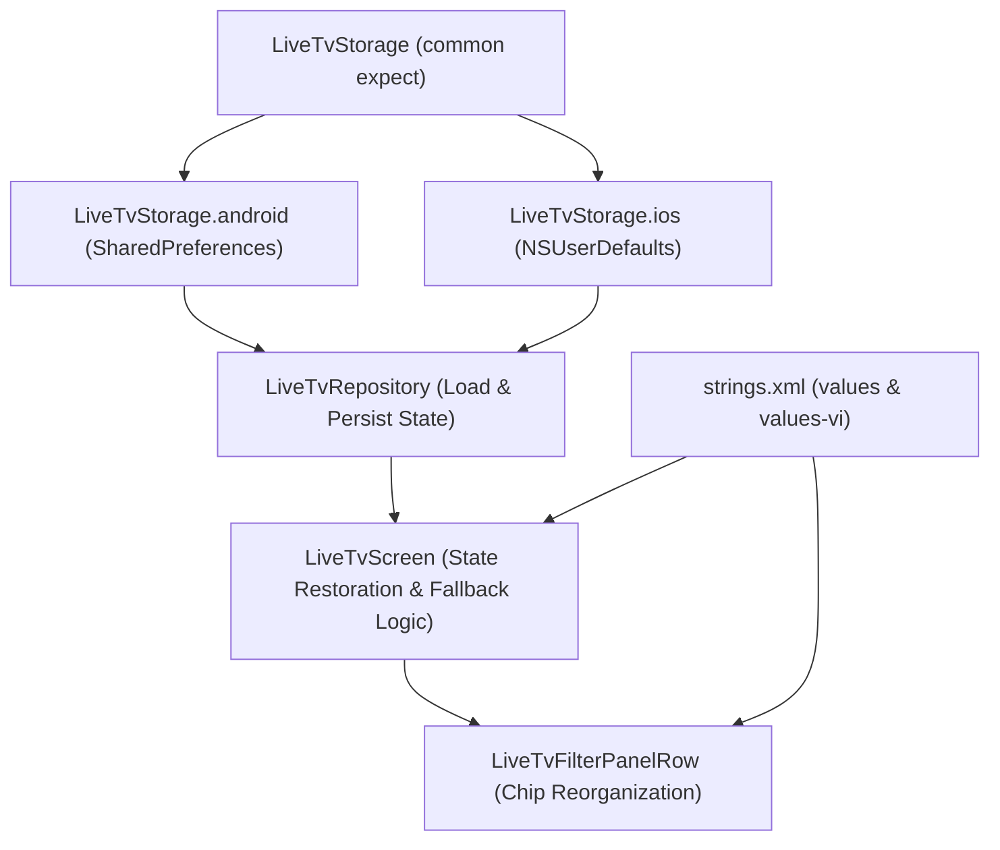

# Kế hoạch Chiến lược: Cải tiến & Tối ưu hóa Trải nghiệm Live TV (Nuvio)

> **Mã kế hoạch**: `PLAN-live-tv-improvements`  
> **Trạng thái**: Chờ duyệt (Pending Review)  
> **Người thực hiện**: Agent mon  
> **Ngày lập**: 19/11/2026  

---

## 🎯 1. Mục tiêu Cốt lõi (Core Goals)

1. **Lưu & Tự động phục hồi Playlist đang xem (Persistence)**:
   - Khắc phục triệt để lỗi khi người dùng vào mục Live TV không lưu danh sách phát (playlist) đang xem, dẫn đến việc thoát ra vào lại bị trống danh sách (không hiện kênh nào).
   - Tự động ghi nhớ `last_selected_playlist_id` vào bộ nhớ cục bộ (`LiveTvStorage`). Khi mở lại Live TV, tự động nạp lại playlist đó và hiển thị danh sách kênh ngay lập tức, fallback thông minh về kênh xem gần nhất hoặc playlist hợp lệ đầu tiên nếu chưa chọn.
2. **Đổi tên "Chọn danh sách phát" ➔ "List Kênh"**:
   - Cập nhật chuỗi giao diện của nút chọn danh sách phát và tiêu đề sheet thành `"List Kênh"`.
3. **Chuyển "Tất cả kênh" vào bên trong "Chọn danh mục"**:
   - Loại bỏ nút chip "Tất cả kênh" rời rạc ở thanh cuộn ngang bên ngoài.
   - Đưa "Tất cả kênh" thành tùy chọn đầu tiên nằm bên trong BottomSheet / menu của danh mục.
4. **Đổi tên "Chọn danh mục" ➔ "Danh mục"**:
   - Đổi nhãn nút chip và tiêu đề sheet từ "Chọn danh mục" thành "Danh mục" ngắn gọn, thanh thoát.
5. **Đổi nhãn "Danh mục yêu thích" ➔ Chỉ có biểu tượng Trái tim và Ngôi sao (`❤️ ⭐`)**:
   - Rút gọn nút Yêu thích trên thanh filter chỉ hiển thị biểu tượng trái tim và ngôi sao, giúp giao diện tối giản, tiết kiệm diện tích tối đa trên màn hình di động.

---

## ⚠️ 2. Phân tích Rủi ro & Kiến trúc Phụ thuộc (Dependency & Risk Analysis)

> [!IMPORTANT]
> **Đồng bộ Đa nền tảng Kotlin Multiplatform (KMP - Android & iOS)**:
> `LiveTvStorage` tuân thủ cơ chế `expect / actual`. Bất kỳ hàm mới nào (`loadLastSelectedPlaylistId`, `saveLastSelectedPlaylistId`) được khai báo ở `commonMain/LiveTvStorage.kt` đều **bắt buộc** phải được triển khai đầy đủ trên:
> - `androidMain/LiveTvStorage.android.kt` (thông qua `SharedPreferences` được mã hóa theo `ProfileScopedKey`).
> - `iosMain/LiveTvStorage.ios.kt` (thông qua `NSUserDefaults` theo `ProfileScopedKey`).

> [!WARNING]
> **Xử lý Biên (Edge Cases) khi khôi phục Playlist**:
> - Playlist đã lưu trước đó có thể bị xóa, bị vô hiệu hóa (`isEnabled = false`), hoặc mất mạng không tải được.
> - **Chiến lược xử lý**: Cần kiểm tra ID đã lưu có nằm trong `activePlaylists` hay không. Nếu không tìm thấy, tự động fallback:
>   1. Kiểm tra playlist của `lastWatchedChannel`.
>   2. Nếu vẫn không có, chọn `activePlaylists.firstOrNull()`.
>   3. Khi có playlist hợp lệ, đặt `filterMode` mặc định là `LiveTvChannelFilterMode.All` thay vì `Favorites` để người dùng thấy ngay danh sách kênh đầy đủ.

> [!NOTE]
> **Tối ưu Hàng Chip Cuộn Ngang (Horizontal Chip Row)**:
> Trước đây hàng chip ngoài gồm: `[ Chọn danh sách phát ] [ Tất cả kênh ] [ Yêu thích ] [ Chọn danh mục v ]`.
> Sau khi tái cấu trúc: `[ List Kênh ] [ ❤️ ⭐ ] [ Danh mục v ]`.
> Hàng chip trở nên vô cùng tinh gọn, không bị tràn màn hình trên các thiết bị có chiều ngang hẹp.

---

## 🗺️ 3. Chuỗi Phụ thuộc Kỹ thuật (Dependency Chain)



---

## 📋 4. Kế hoạch Triển khai Chi tiết (Phase-by-Phase Breakdown)

### 🔹 Giai đoạn 1: Bổ sung Lưu trữ Trạng thái Playlist (Storage & Repository)
- **Tệp chỉnh sửa**:
  - `composeApp/src/commonMain/kotlin/com/nuvio/app/features/livetv/LiveTvStorage.kt`
  - `composeApp/src/androidMain/kotlin/com/nuvio/app/features/livetv/LiveTvStorage.android.kt`
  - `composeApp/src/iosMain/kotlin/com/nuvio/app/features/livetv/LiveTvStorage.ios.kt`
  - `composeApp/src/commonMain/kotlin/com/nuvio/app/features/livetv/LiveTvRepository.kt`
- **Hành động cụ thể**:
  1. Thêm key `last_selected_playlist_id` vào `LiveTvStorage`.
  2. Định nghĩa hàm `loadLastSelectedPlaylistId(): String?` và `saveLastSelectedPlaylistId(playlistId: String?)`.
  3. Trong `LiveTvRepository`, hỗ trợ hàm helper lưu và truy xuất `lastSelectedPlaylistId`.

### 🔹 Giai đoạn 2: Cập nhật Resource Chuỗi Đa ngôn ngữ (Strings Localization)
- **Tệp chỉnh sửa**:
  - `composeApp/src/commonMain/composeResources/values-vi/strings.xml`
  - `composeApp/src/commonMain/composeResources/values/strings.xml`
- **Hành động cụ thể**:
  1. `live_tv_filter_select_playlist`: Đổi từ `"Chọn danh sách phát"` ➔ `"List Kênh"` (Values EN: `"Channel List"` / `"List Kênh"`).
  2. `live_tv_filter_choose_category`: Đổi từ `"Chọn danh mục"` ➔ `"Danh mục"` (Values EN: `"Categories"`).
  3. `live_tv_filter_favorites`: Cập nhật thành `"❤️ ⭐"` (hoặc giữ nội dung bổ trợ cho TalkBack/Accessibility với biểu tượng trực quan).

### 🔹 Giai đoạn 3: Tái cấu trúc Giao diện Hàng Chip (LiveTvFilterPanelRow)
- **Tệp chỉnh sửa**:
  - `composeApp/src/commonMain/kotlin/com/nuvio/app/features/livetv/LiveTvFilterPanelRow.kt`
- **Hành động cụ thể**:
  1. **Bỏ chip "Tất cả kênh" ở hàng ngoài**: Xóa khối render `LiveTvPanelFilterChip(label = allLabel, ...)` khỏi thanh `Row` ngoài.
  2. **Bảo toàn "Tất cả kênh" trong `LiveTvCategoryOptionsSheet`**: Đảm bảo tùy chọn "Tất cả kênh" (`LiveTvFilterSheetRow(title = allLabel, icon = Icons.Rounded.Tv, ...)`) nằm ngay vị trí đầu tiên trong danh sách danh mục khi bấm vào chip `"Danh mục"`.
  3. **Hiển thị chip Yêu thích bằng biểu tượng Trái tim và Ngôi sao**:
     - Thiết kế chip Yêu thích hiển thị biểu tượng kép `Favorite` và `Star` (hoặc icon kết hợp text `❤️ ⭐`), đồng bộ màu sắc `accent` khi đang kích hoạt và màu `textSecondary` khi không kích hoạt.
  4. **Cập nhật chip "Danh mục"**:
     - Hiển thị nhãn `"Danh mục"` khi người dùng chọn "Tất cả kênh" (hoặc chưa chọn category con).
     - Khi người dùng chọn một danh mục cụ thể (vd: "Thời sự"), hiển thị tên danh mục đó kèm mũi tên xổ xuống.

### 🔹 Giai đoạn 4: Hoàn thiện Logic Phục hồi Trạng thái trên Màn hình (LiveTvScreen)
- **Tệp chỉnh sửa**:
  - `composeApp/src/commonMain/kotlin/com/nuvio/app/features/livetv/LiveTvScreen.kt`
- **Hành động cụ thể**:
  1. Khởi tạo `selectedPlaylistId` bằng giá trị đọc từ `LiveTvStorage.loadLastSelectedPlaylistId()`.
  2. Thiết lập cơ chế tự động phục hồi trong `LaunchedEffect(activePlaylists)`:
     - Nếu `selectedPlaylistId` lưu trước đó tồn tại trong `activePlaylists` ➔ Giữ nguyên và chọn playlist đó.
     - Nếu `selectedPlaylistId` bị null hoặc không còn hợp lệ, nhưng `activePlaylists` có dữ liệu:
       - Ưu tiên chọn playlist của `lastWatchedChannel` (nếu nằm trong `activePlaylists`).
       - Nếu không có, tự động chọn `activePlaylists.first().id`.
     - Lưu lại playlist ID đã chọn vào `LiveTvStorage`.
  3. Cập nhật `filterMode`: Khi có playlist được chọn tự động, đặt `filterMode = LiveTvChannelFilterMode.All` để hiển thị ngay lập tức danh sách kênh của playlist đó, không bị màn hình trống.
  4. Khi người dùng bấm chuyển playlist trong sheet, lưu ngay ID mới vào `LiveTvStorage.saveLastSelectedPlaylistId(playlist?.id)`.

---

## 🧪 5. Kế hoạch Kiểm thử & Nghiệm thu (Verification Plan)

### A. Kiểm thử Tự động (Automated Verification)
- [ ] Chạy lệnh biên dịch Metadata Kotlin Multiplatform:
  ```powershell
  ./gradlew :composeApp:compileCommonMainKotlinMetadata
  ```
- [ ] Chạy Unit Test cho Live TV:
  ```powershell
  ./gradlew :composeApp:testAndroidHostTest --tests "com.nuvio.app.features.livetv.LiveTvRepositoryTest"
  ```
- [ ] Bổ sung test case kiểm tra việc lưu và nạp `lastSelectedPlaylistId` cùng logic fallback playlist khi khởi tạo.

### B. Kiểm thử Thủ công (Manual Verification Walkthrough)
1. **Kiểm tra Lưu & Phục hồi Danh sách phát**:
   - Mở ứng dụng, vào tab Live TV.
   - Chọn một playlist bất kỳ (vd: Xtream hoặc Playlist M3U).
   - Thoát ra màn hình Home hoặc chuyển sang tab Cài đặt, sau đó quay lại Live TV ➔ Danh sách kênh của playlist đó phải xuất hiện ngay, không bị trống hay mất danh sách.
   - Đóng hẳn ứng dụng (Kill task) rồi mở lại ➔ Live TV vẫn ghi nhớ đúng playlist vừa xem.
2. **Kiểm tra Thay đổi Tên & Hàng Filter Chip**:
   - Chip đầu tiên hiển thị nhãn `"List Kênh"` (khi chưa chọn hoặc trong tiêu đề sheet).
   - Không còn nút chip "Tất cả kênh" đứng riêng lẻ ở ngoài thanh cuộn ngang.
   - Nút Yêu thích hiển thị biểu tượng trái tim và ngôi sao (`❤️ ⭐`).
   - Nút danh mục hiển thị nhãn `"Danh mục"`.
3. **Kiểm tra Tùy chọn "Tất cả kênh" trong "Danh mục"**:
   - Bấm vào chip `"Danh mục"` ➔ Sheet mở lên với mục đầu tiên là "Tất cả kênh".
   - Bấm chọn "Tất cả kênh" ➔ Sheet đóng, toàn bộ kênh của playlist được hiển thị đầy đủ.
   - Chọn một danh mục con (vd: "Thể thao") ➔ Chỉ các kênh thuộc danh mục đó hiển thị.
