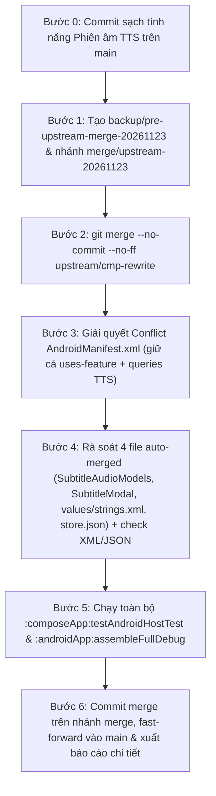

# Kế hoạch Chiến lược: Đồng bộ Commit mới nhất từ NuvioMedia/NuvioMobile Upstream (18/11 ➔ 23/11/2026)

> **Mã kế hoạch**: `PLAN-merge-upstream-20261123`  
> **Trạng thái**: Sẵn sàng thực thi (Pending Execution)  
> **Người lập**: Agent mon  
> **Ngày lập**: 23/11/2026  
> **Nguồn upstream**: `https://github.com/NuvioMedia/NuvioMobile.git` (Remote: `upstream`, Nhánh: `cmp-rewrite` — đã tích hợp cả `upstream/main` / `hotfix-1.0.1`)  
> **Nhánh đích**: `main` (Remote: `origin`, `https://github.com/9000000/NuvioMobile-Fast.git`)  
> **Điểm cơ sở (Merge Base)**: `b66f7725c` (`2026-11-18`, `chore(store): publish 1.1.0-beta.2`)  
> **Đỉnh upstream mới nhất**: `642f6e031` (`2026-11-21`, `Merge pull request #2705 from skoruppa/fix/jellyfin-auth-per-profile`)  
> **Quy mô thay đổi upstream**: **40 commits** (`13` first-parent merges/commits), **39 files** (`+4.837` / `-1.427` dòng)

---

## 🎯 1. Mục tiêu Cốt lõi & Hiện trạng Hai nhánh

### Mục tiêu
1. Cập nhật đầy đủ toàn bộ **40 commit mới nhất** từ `upstream/cmp-rewrite` (`b66f7725c..642f6e031`, từ ngày `18/11/2026` đến hôm nay `23/11/2026`) vào nhánh `main` của `NuvioMobile-Fast`.
2. Giải quyết triệt để **1 file xung đột thực tế** (`androidApp/src/main/AndroidManifest.xml`) và rà soát ngữ nghĩa **4 file giao nhau** (`SubtitleAudioModels.kt`, `SubtitleModal.kt`, `values/strings.xml`, `store.json`).
3. **Bảo toàn 100%** mọi tùy chỉnh độc quyền của `NuvioMobile-Fast` (bao gồm cả tính năng **Phiên âm tên riêng & từ tiếng Anh TTS** vừa hoàn thành trên working tree).
4. Đánh giá minh bạch mọi phần code mới từ upstream (cái nào vượt trội được nhận, cái nào giữ nguyên của nhánh Fast) và xác minh bằng toàn bộ bộ kiểm thử tự động + biên dịch `assembleFullDebug`.

### Hiện trạng Working Tree & Nhánh `main`
- Nhánh `main` đang ở `8651deac9` (tag `v1.2.8`), chứa 9 commit tùy chỉnh sau đợt merge trước (`c9898a79b`): Live TV, Simkl OAuth V2, Trakt OAuth PKCE, hệ thống TTS Offline (Google Speech + Piper ONNX + Timing Sync + `<queries>` trong Manifest).
- **Working tree hiện có thay đổi chưa commit** của tính năng `PLAN-tts-english-proper-name-transliteration` (10 file sửa, 5 file mới + `tts_en_vi_dict.tsv`).

> [!IMPORTANT]
> **Điều kiện tiên quyết (Pre-flight Gate)**:
> - **Bắt buộc phải commit sạch toàn bộ tính năng Phiên âm TTS hiện có trên `main`** (và tạo nhánh làm việc an toàn `merge/upstream-20261123` + nhánh sao lưu `backup/pre-upstream-merge-20261123`) **trước khi chạy `git merge`**, tránh tuyệt đối rủi ro trộn lẫn hoặc mất thay đổi chưa commit.

---

## 🌟 2. Tổng hợp Chi tiết 40 Commit Mới từ Upstream (18/11 ➔ 21/11/2026)

| Nhóm thay đổi | Commit / PR tiêu biểu | Tệp bị ảnh hưởng | Phân tích & Giá trị mang lại | Quyết định |
| :--- | :--- | :--- | :--- | :--- |
| **1. Tách phiên Jellyfin/Emby theo từng Profile** | PR #2705 (`642f6e031`, `99f57aa97`) | `ServerRepository.kt`, `MediaBrowserClient.kt`, `ServerProfileDeviceIdTest.kt` | Tạo `profileScopedDeviceId(clientId, profileId)` (profile 1 giữ `clientId`, profile phụ dùng `"$clientId-p$profileId"`). Tránh đá phiên đăng nhập giữa các profile khác nhau trên cùng thiết bị. | **Chấp nhận 100%** (Code mới tốt hơn, có sẵn unit test) |
| **2. Hiển thị nhãn (`label`) phụ đề Stremio** | PR #2714 (`e022cfdf7`, `2954c9dc7`, `1f4c245d8`) | `AddonSubtitleLoader.kt`, `SubtitleAudioModels.kt`, `SubtitleModal.kt` | Parse trường `"label"` của phụ đề từ addon Stremio vào `AddonSubtitle.title`, hiển thị làm tiêu đề dòng thay vì chỉ hiện tên ngôn ngữ chung chung. | **Chấp nhận & Giữ song song** với nút `+ Thêm phụ đề` và font/outline `1..10` của Fast |
| **3. Wi-Fi không bắt buộc trên Android** | `c5a73772f` | `androidApp/src/main/AndroidManifest.xml` | Thêm `<uses-feature android:name="android.hardware.wifi" android:required="false" />` để không bị chặn cài đặt trên thiết bị không có phần cứng Wi-Fi (Ethernet/di động). | **Hợp nhất (Merge Conflict)** — giữ cả `<uses-feature>` mới và `<queries>` TTS của Fast |
| **4. Sửa căn giữa tiêu đề DetailHero** | PR #2735 (`74ecdef47`, `23d93d004`) | `DetailHero.kt` | Thêm `modifier = Modifier.fillMaxWidth()` cho tiêu đề phim `Text(text = meta.name)` để `TextAlign.Center` căn giữa chuẩn xác. | **Chấp nhận 100%** (Bản vá UI sạch, 1 dòng) |
| **5. Nhập nhánh `hotfix-1.0.1` & `store.json`** | `5a20c17a3`, `3cfc311b4`, `f86087dcd` | `store.json` (các fix code trong `hotfix-1.0.1` đã có sẵn từ `b66f7725c`) | Chỉ bổ sung bản ghi release `1.0.1` vào `store.json`; các bản vá `c31c30e1e`, `4baf886ee`, `f81edc653`, `103c5e07a` đã tồn tại từ đợt merge 19/11. | **Rà soát sau auto-merge** (kiểm tra JSON hợp lệ, báo cáo rõ) |
| **6. Chuẩn hóa & Mở rộng Đa ngôn ngữ (i18n)** | `1017527e3`, `729dd9f61`, `b39dff6f6`, `d6584fd31`, `c4c871017`, `ee4c70ced`, `22cf522d2` | `values/strings.xml`, `values-iw/*` (mới), `values-he/*`, `values-hu/*`, `values-es/*`, `values-fr/*`, `values-tr/*`, `values-sk/*` | Chuẩn hóa viết hoa Title Case cho nhãn bộ lọc Library (`All Types`, `Select List`, `Sort Library`...); thêm `values-iw` để Android cũ nhận tiếng Do Thái; cập nhật 5 ngôn ngữ châu Âu. **Không đụng vào `values-vi/strings.xml`**. | **Chấp nhận 100%** (Kiểm tra không trùng key trong `values/strings.xml`) |

---

## 💥 3. Phân tích Dry-Run (`git merge-tree`) — Xung đột & File Giao nhau

Kết quả mô phỏng `git merge-tree --write-tree HEAD upstream/cmp-rewrite` xác định chính xác **1 Hard Conflict** và **4 Overlapping Auto-Merged Files**:

### 🔴 Hard Conflict (1 file): `androidApp/src/main/AndroidManifest.xml`
- **Phía nhánh Fast (`HEAD` — commit `8651deac9`)**:
  ```xml
      <queries>
          <intent>
              <action android:name="android.intent.action.TTS_SERVICE" />
          </intent>
          <intent>
              <action android:name="android.speech.tts.engine.INSTALL_TTS_DATA" />
          </intent>
          <intent>
              <action android:name="android.speech.tts.engine.CHECK_TTS_DATA" />
          </intent>
          <package android:name="com.google.android.tts" />
      </queries>
  ```
- **Phía Upstream (`c5a73772f`)**:
  ```xml
      <uses-feature
          android:name="android.hardware.wifi"
          android:required="false" />
  ```
- **Phương án giải quyết**: **Giữ trọn vẹn cả hai khối** — đặt `<uses-feature android:name="android.hardware.wifi" android:required="false" />` ngay sau `<uses-permission>`, kế tiếp là toàn bộ khối `<queries>` TTS của `NuvioMobile-Fast`. Không mất bất kỳ quyền/khả năng nào của hai bên.

### 🟡 4 File Giao nhau (Auto-Merged — Bắt buộc rà soát thủ công)
1. **`composeApp/src/commonMain/kotlin/com/nuvio/app/features/player/SubtitleAudioModels.kt`**:
   - *Local*: `subtitleFontFamily(...)` (PhimMoi, Oswald, Sans-Serif, Serif, Monospace) và `subtitleOutlineWidthRange: IntRange = 1..10`.
   - *Upstream*: Thêm `val title: String? = null` vào `data class AddonSubtitle`.
   - *Kiểm chứng sau merge*: Đảm bảo giữ nguyên `subtitleFontFamily`, range `1..10`, đồng thời có trường `title: String? = null`.
2. **`composeApp/src/commonMain/kotlin/com/nuvio/app/features/player/SubtitleModal.kt`**:
   - *Local*: Nút `SubtitleImportRow` (`+ Thêm phụ đề`) và `rememberSubtitleFilePickerLauncher` tạo `AddonSubtitle(id = ..., url = fileUri, language = "local", display = name, addonName = "Storage")`.
   - *Upstream*: Đổi dòng hiển thị tiêu đề phụ đề addon thành `title = option.subtitle.title ?: languageLabelForCode(option.subtitle.language)`.
   - *Kiểm chứng sau merge*: Đảm bảo `SubtitleImportRow` còn nguyên vẹn và tương thích 100% với trường `title` mặc định `null` (không lỗi compile, không ảnh hưởng phụ đề nội bộ).
3. **`composeApp/src/commonMain/composeResources/values/strings.xml`**:
   - *Upstream*: Cập nhật 11 chuỗi Library sang Title Case (`All Types`, `Select List`, `Sort Library`...).
   - *Kiểm chứng sau merge*: Chạy script kiểm tra XML hợp lệ và **0 key bị trùng lặp**, đồng thời xác nhận các key tùy chỉnh của Fast (`compose_player_add_subtitle`, Live TV, TorrServer...) còn nguyên vẹn.
4. **`store.json`**:
   - *Upstream*: Chèn bản ghi phát hành `1.0.1` vào mảng `versions[]`.
   - *Kiểm chứng sau merge*: Kiểm tra cú pháp JSON hợp lệ bằng parser, báo cáo rõ khác biệt cho người dùng.

---

## 🛡️ 4. Danh mục Tùy chỉnh Độc quyền của NuvioMobile-Fast (Đảm bảo Bảo tồn 100%)

> [!NOTE]
> Đối chiếu danh sách 39 file upstream thay đổi cho thấy **0% file đụng chạm** vào các phân hệ tùy chỉnh sau của `NuvioMobile-Fast`:
> 1. **Hệ thống TTS Offline & Phiên âm tên riêng tiếng Anh**: toàn bộ `features/player/tts/*` (System TTS, Piper ONNX `sherpa-onnx`, Timing Sync, `TtsPhoneticDictionary`, `EnglishToVietnameseTransliterator`, `tts_en_vi_dict.tsv`), `PlaybackAudioTtsSettings.kt`, `SettingsSearch.kt`, `composeApp/proguard-rules.pro` *(duy nhất `<queries>` trong `AndroidManifest.xml` sẽ được giữ nguyên khi giải quyết conflict)*.
> 2. **Live TV Module**: toàn bộ `features/livetv/*`, `PlayerLiveChannelsPanel.kt`, tab điều hướng.
> 3. **TorrServer & P2P**: toàn bộ `features/torrserver/*`, `TorrentFilePickerDialog.kt`.
> 4. **OAuth 2.0 Mới**: Trakt OAuth 2.0 PKCE (`6b3093202`) & Simkl OAuth 2.0 Auth V2 (`ad3189621`).
> 5. **Mạng, Font chữ & Bản địa hóa Tiếng Việt**: `IPv4FirstDns.kt`, `DynamicHostFallback.kt`, `values-vi/strings.xml`, font `Oswald`/`PhimMoi`, `SubtitleViewOutline.kt`, `OutlineSpan.kt`.
> 6. **Cấu hình Build & Phiên bản**: `androidApp/build.gradle.kts`, `iosApp/Configuration/Version.xcconfig` (`1.2.8`), `README.md`, `release.bat`, `scripts/`.

---

## 🗺️ 5. Chuỗi Phụ thuộc & Quy trình Thực thi (Execution Flow)



---

## 📋 6. Phân rã Task Triển khai (Surgical Task Breakdown)

### 🔹 Task 1 (`TASK-SYNC-261123-01`): Chốt Commit Tính năng Phiên âm TTS & Tạo Nhánh An toàn
**Phụ trách**: `git-specialist` / `orchestrator`
- [ ] Kiểm tra `git status`, stage và commit sạch toàn bộ thay đổi đã kiểm chứng của tính năng phiên âm tên riêng & từ tiếng Anh TTS trên `main`.
- [ ] Tạo nhánh sao lưu `backup/pre-upstream-merge-20261123` tại điểm commit mới nhất của `main`.
- [ ] Tạo và chuyển sang nhánh làm việc `merge/upstream-20261123`.

### 🔹 Task 2 (`TASK-SYNC-261123-02`): Thực thi Merge `upstream/cmp-rewrite` & Giải quyết Conflict `AndroidManifest.xml`
**Phụ trách**: `backend-specialist`
- [ ] Chạy `git merge --no-commit --no-ff upstream/cmp-rewrite`.
- [ ] Xác nhận danh sách file conflict thực tế khớp dự đoán (`androidApp/src/main/AndroidManifest.xml`).
- [ ] Giải quyết `androidApp/src/main/AndroidManifest.xml`: giữ nguyên `<uses-feature android:name="android.hardware.wifi" android:required="false" />` của upstream VÀ toàn bộ khối `<queries>` cho TTS (`TTS_SERVICE`, `INSTALL_TTS_DATA`, `CHECK_TTS_DATA`, `com.google.android.tts`) của Fast. Đánh dấu `git add androidApp/src/main/AndroidManifest.xml`.

### 🔹 Task 3 (`TASK-SYNC-261123-03`): Rà soát Ngữ nghĩa 4 File Auto-Merged & Kiểm tra Toàn vẹn XML/JSON
**Phụ trách**: `quality-inspector`
- [ ] Rà soát `SubtitleAudioModels.kt`: xác nhận còn nguyên `subtitleFontFamily(...)`, `subtitleOutlineWidthRange = 1..10`, và đã có `val title: String? = null` trong `AddonSubtitle`.
- [ ] Rà soát `SubtitleModal.kt`: xác nhận còn nguyên nút `SubtitleImportRow` (`+ Thêm phụ đề`) + `rememberSubtitleFilePickerLauncher`, đồng thời đã tích hợp `option.subtitle.title ?: languageLabelForCode(...)`.
- [ ] Rà soát `values/strings.xml` & `values-iw/*`: chạy kiểm tra XML well-formed và **0 duplicate string keys**.
- [ ] Rà soát `store.json`: kiểm tra cú pháp JSON hợp lệ sau merge.
- [ ] Kiểm tra `iosApp/Configuration/Version.xcconfig`, `values-vi/strings.xml`, `features/livetv/*`, `features/torrserver/*`, `features/player/tts/*` không bị ghi đè ngoài ý muốn.

### 🔹 Task 4 (`TASK-SYNC-261123-04`): Kiểm thử Tự động & Biên dịch Xác minh (Verification)
**Phụ trách**: `test-engineer`
- [ ] Chạy toàn bộ bộ test (bao gồm cả `ServerProfileDeviceIdTest` mới từ upstream và toàn bộ 9 test suites TTS):
  ```powershell
  .\gradlew.bat :composeApp:testAndroidHostTest "-Pnuvio.android.distribution=full" --console=plain
  ```
  Kỳ vọng: **100% PASS (0 failures, 0 errors)**.
- [ ] Biên dịch và đóng gói Android Full Debug:
  ```powershell
  .\gradlew.bat :androidApp:assembleFullDebug "-Pnuvio.android.distribution=full" --console=plain
  ```
  Kỳ vọng: **`BUILD SUCCESSFUL`**, kiểm tra Manifest hợp nhất chứa cả `android.hardware.wifi` (`required="false"`) và `<queries>` TTS.

### 🔹 Task 5 (`TASK-SYNC-261123-05`): Hoàn tất Merge vào `main` & Báo cáo Chi tiết
**Phụ trách**: `orchestrator`
- [ ] Commit merge trên `merge/upstream-20261123` với thông điệp chuẩn:
  `Merge upstream/cmp-rewrite (18/11/2026 - 21/11/2026, 40 commits -> 642f6e031)`
- [ ] Chuyển về `main`, fast-forward từ `merge/upstream-20261123`.
- [ ] Cập nhật `task.md` và xuất báo cáo nghiệm thu chi tiết (liệt kê từng thay đổi upstream đã nhận, cách xử lý từng xung đột, và xác nhận các tùy chỉnh được bảo toàn).

---

## ⚠️ 7. Ma trận Rủi ro & Biện pháp Kiểm soát

| Rủi ro | Mức độ | Biện pháp kiểm soát |
| :--- | :---: | :--- |
| **Mất thay đổi chưa commit của tính năng Phiên âm TTS** | Cao (nếu quên) | Bắt buộc commit sạch tính năng Phiên âm TTS + tạo nhánh `backup/pre-upstream-merge-20261123` ở Task 1 trước khi merge. |
| **Mất `<queries>` TTS trên Android 11+ / ROM Trung Quốc** | Trung bình | Giải quyết conflict `AndroidManifest.xml` thủ công giữ đủ cả `<uses-feature>` mới và `<queries>` cũ, verify trên merged manifest. |
| **Xung đột resource XML do thêm `values-iw/` hoặc `values/strings.xml`** | Thấp | Xác minh trực tiếp bằng `:composeApp:testAndroidHostTest` + `:androidApp:assembleFullDebug` (biên dịch tài nguyên Compose & Android AAPT2). |
| **Hỏng tương thích nút `+ Thêm phụ đề` trong `SubtitleModal.kt`** | Thấp | `AddonSubtitle.title` có giá trị mặc định `= null`, kiểm tra trực tiếp diff `SubtitleModal.kt` và chạy test biên dịch đầy đủ. |
