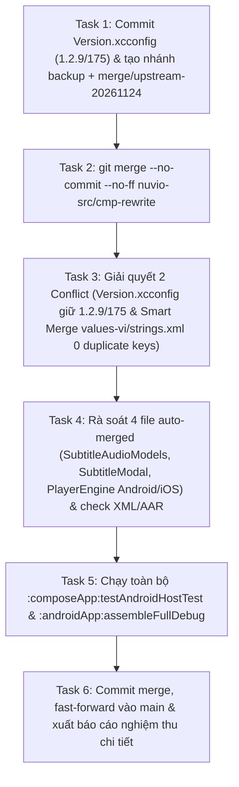

# Kế hoạch Chiến lược: Đồng bộ Commit mới nhất từ `9000000/NuvioMobile` (`22/11/2026` ➔ `24/11/2026`)

> **Mã kế hoạch**: `PLAN-merge-upstream-20261124`  
> **Trạng thái**: Chờ duyệt để thực thi (Pending Review)  
> **Người lập**: Agent mon  
> **Ngày lập**: 24/11/2026  
> **Nguồn upstream**: `https://github.com/9000000/NuvioMobile.git` (Remote: `nuvio-src`, Nhánh: `cmp-rewrite`)  
> **Nhánh đích**: `main` (Remote: `origin`, `https://github.com/9000000/NuvioMobile-Fast.git`)  
> **Điểm cơ sở (Merge Base)**: `642f6e031` (`2026-11-21`, `Merge pull request #2705 from skoruppa/fix/jellyfin-auth-per-profile`)  
> **Đỉnh upstream mới nhất**: `4ec93635a` (`2026-11-24 03:02:43 +0300`, `bump version`)  
> **Quy mô thay đổi upstream**: **33 commits** (`11` first-parent commits/merges), **32 files** (`+3.253` / `-41` dòng + 2 binary AAR)

---

## 🎯 1. Mục tiêu Cốt lõi & Hiện trạng Working Tree

### Mục tiêu
1. Cập nhật đầy đủ toàn bộ **33 commit mới nhất** từ `nuvio-src/cmp-rewrite` (`642f6e031..4ec93635a`) vào nhánh `main` của `NuvioMobile-Fast`.
2. Giải quyết triệt để **2 file Hard Conflict** (`values-vi/strings.xml`, `iosApp/Configuration/Version.xcconfig`) và rà soát kỹ **4 file Auto-Merged giao nhau** (`PlayerEngine.android.kt`, `SubtitleAudioModels.kt`, `SubtitleModal.kt`, `PlayerEngine.ios.kt`).
3. **Bảo toàn 100%** toàn bộ các tùy chỉnh độc quyền của `NuvioMobile-Fast` (TTS Offline + Phiên âm tiếng Anh, Live TV, TorrServer, OAuth 2.0 Trakt PKCE / Simkl V2, IPv4FirstDns, Font Oswald/PhimMoi, range viền `1..10`, nút `+ Thêm phụ đề`, 130 chuỗi tiếng Việt riêng, phiên bản `1.2.9` / `175`).
4. Áp dụng các cải tiến kỹ thuật vượt trội từ upstream (nâng cấp AAR Media3 MKV/DTS/M2TS, badge phụ đề ASS/PGS/VobSub/DVB, nâng max font phụ đề `60sp`, chống OOM phản hồi Addon, bỏ sync cloud cho Guest, chuẩn hóa media type JS plugin, dịch tiếng Việt Plex/Silo + `<plurals>`), kiểm thử đầy đủ và báo cáo minh bạch từng điểm.

### Hiện trạng Working Tree
- Nhánh `main` đang ở `29c26fd54` (đã đồng bộ xong tới `642f6e031` và đã tích hợp tính năng Phiên âm TTS).
- Working tree đang có **1 thay đổi chưa commit**:
  - `M iosApp/Configuration/Version.xcconfig`: nâng từ `1.2.8` (`174`) ➔ **`1.2.9` (`175`)**.

> [!IMPORTANT]
> **Điều kiện tiên quyết (Pre-flight Gate)**:
> - Bước đầu tiên sẽ chốt commit `iosApp/Configuration/Version.xcconfig` (`1.2.9` / `175`) trên `main` (hoặc lưu giữ và bảo toàn tuyệt đối giá trị `1.2.9` / `175`), tạo nhánh sao lưu `backup/pre-upstream-merge-20261124` và thực hiện toàn bộ merge trên nhánh riêng `merge/upstream-20261124`.

---

## 🌟 2. Tổng hợp & Đánh giá Chi tiết 9 Nhóm Thay đổi từ `nuvio-src/cmp-rewrite`

| # | Nhóm tính năng / Bản vá | PR / Commit | Tệp bị ảnh hưởng | Phân tích & Giá trị so với code hiện tại | Quyết định |
| :-: | :--- | :--- | :--- | :--- | :--- |
| 1 | **Cập nhật Media3 Common & Extractor AAR (MKV, DTS, BDAV M2TS)** | PR #2747 (`5a9b32a0d`, `3e63c3ab8`) | `composeApp/libs/lib-common-release.aar`, `composeApp/libs/lib-extractor-release.aar` | Bản dựng Media3 mới tích hợp các bản vá tách luồng MKV, âm thanh DTS và Blu-ray BDAV M2TS từ NuvioTV. | **Chấp nhận 100%** *(tốt hơn bản AAR cũ)* |
| 2 | **Badge định dạng phụ đề (`ASS`, `PGS`, `VobSub`, `DVB`) & rút gọn tên Addon dài** | PR #2750 (`8cd69c1ea`, `6c7386681`, `a0da4691e`) | `SubtitleAudioModels.kt`, `SubtitleModal.kt`, `SubtitleSelectionModel.kt`, `CustomDefaultTrackNameProvider.kt`, `PlayerEngine.android.kt`, `PlayerBridge.kt`, `PlayerEngine.ios.kt`, `MPVPlayerBridge.swift` | Hiển thị nhãn chip định dạng `ASS`/`PGS`/`VobSub`/`DVB` rõ ràng thay vì chuỗi codec thô; thêm `Modifier.weight(1f, fill = false)` ở `SubtitleSourceChip` để tên addon dài không đẩy mất chip `AutoSynced`. | **Chấp nhận 100%** *(UI/UX tốt hơn hẳn; giữ nguyên nút `+ Thêm phụ đề` và tùy biến của Fast)* |
| 3 | **Nâng cỡ chữ phụ đề tối đa trên Android lên `60sp` (ExoPlayer & libmpv)** | PR #2709 (`a33b06821`, `2e2154856`, `dec0f3286`) | `SubtitleAudioModels.kt` (`12..40` ➔ `12..60`), `PlayerEngine.android.kt` (`MPV_SUBTITLE_FONT_SIZE_MAX`: `122` ➔ `183`) | Cho phép phóng to phụ đề tới `60sp` trên Android cả ExoPlayer lẫn libmpv (iOS giữ `6..40`). | **Chấp nhận 100%** *(tốt hơn giới hạn `40sp` cũ; giữ nguyên `subtitleOutlineWidthRange = 1..10` của Fast)* |
| 4 | **Giới hạn kích thước phản hồi HTTP Addon trên Android (chống OOM)** | PR #2490 (`6f1e3c4e2`, `ba573755b`) | `AddonPlatform.android.kt`, `AddonHttpTextLimitTest.kt` | Đổi `readResponseBody` từ `body.bytes()` không giới hạn sang `readResponseBodyLimited(body, API_RESPONSE_MAX_BYTES)` tránh crash OOM khi addon trả payload lỗi khổng lồ. Không ảnh hưởng `IPv4FirstDns`. | **Chấp nhận 100%** *(an toàn hơn code cũ, có kèm unit test)* |
| 5 | **Bỏ đồng bộ Addon lên Cloud với phiên Khách (Guest)** | PR #1846 (`0317311a7`, `c72103eca`) | `AddonRepository.kt`, `AddonSyncEligibilityTest.kt` | Thêm `shouldPushAddonsToServer(authState)` chặn gọi RPC Supabase khi `isAnonymous == true` hoặc chưa đăng nhập. | **Chấp nhận 100%** *(giảm lỗi mạng & request thừa, có unit test)* |
| 6 | **Bảo toàn kiểu `series` cho JS Plugin ở ranh giới TMDB** | PR #2080 (`7f7cf47c4`, `c5dc94c0a`, `44835b62b`, `f14ff2b97`) | `PluginMediaType.kt`, `PluginRepository.kt`, `PluginMediaTypeTest.kt` | Thêm `jsPluginMediaType(...)` khôi phục `"series"` cho JS plugin khai báo hỗ trợ `"series"` sau khi TMDB bridge đổi sang `"tv"`, không ảnh hưởng plugin cũ dùng `"tv"`. | **Chấp nhận 100%** *(sửa lỗi tương thích plugin, có unit test)* |
| 7 | **Bổ sung bản dịch Tiếng Việt (Plex, Silo, Downloads Plurals & sửa typo)** | PR #2683 (`59f56b20f`, `06baa1b21`, `e492e5e31`, `fb153eea5`) | `values-vi/strings_servers.xml` (+55 chuỗi Plex/Silo), `values-vi/strings.xml` (**CONFLICT #1**) | Bổ sung toàn bộ 55 chuỗi Plex/Silo đang thiếu 100% trên Fast; thêm 2 `<plurals>` (`downloads_episodes`, `downloads_titles`); sửa dấu `"` thừa ở `library_layout_show_horizontal`. | **Hợp nhất thông minh** *(nhận hết phần thiếu/sửa lỗi, khử 20 key trùng, giữ 100% 130 key tùy chỉnh của Fast)* |
| 8 | **Thêm ngôn ngữ Tiếng Trung Phồn Thể (`zh-Hant`) & sửa chữ `mpv` tiếng Pháp** | PR #1973 (`55b8d626a`, `4f11b15f5`, `e53467f6d`) | `values-b+zh+Hant/*` (8 file), `AppLanguage.kt`, `locale_config.xml`, `iosApp/iosApp/Info.plist`, `values-fr/strings.xml` | Hỗ trợ đầy đủ `zh-Hant` cho Android và iOS. | **Chấp nhận 100%** |
| 9 | **Bump version upstream (`1.1.0-beta.3` / `161`)** | `4ec93635a` | `iosApp/Configuration/Version.xcconfig` (**CONFLICT #2**) | Upstream bump lên `1.1.0-beta.3` (`161`); nhánh Fast đang ở `1.2.9` (`175`). | **Giữ nguyên bản Fast** (`1.2.9` / `175`) |

---

## 💥 3. Phân tích Dry-Run (`git merge-tree`) — 2 Hard Conflicts & 4 File Giao nhau

Kết quả mô phỏng không can thiệp `git merge-tree --write-tree HEAD nuvio-src/cmp-rewrite` xác định chính xác:

### 🔴 Hard Conflict #1: `composeApp/src/commonMain/composeResources/values-vi/strings.xml`
- **Nguyên nhân sâu xa (đã đối chiếu từng key bằng XML parser)**:
  - Trên `HEAD`, file `values-vi/strings.xml` có `2.670` strings gồm: các chuỗi chuẩn + `130` chuỗi độc quyền của Fast (Live TV, TorrServer, Subtitle Font...) + `20` chuỗi mới (Tracking Addons, Downloads redesign, Library filter, `subtitle_outline_width`) đã được thêm thủ công ở đợt merge 19/11 (nằm ở phần cuối file).
  - PR #2683 của upstream bổ sung đúng `20` chuỗi đó vào đúng vị trí theo thứ tự chữ cái (nên **xung đột & có nguy cơ trùng lặp 20 key nếu gộp cơ học!**), đồng thời:
    1. Bổ sung **2 thẻ `<plurals>`** mà `HEAD` đang **thiếu**: `downloads_episodes` (`%1$d tập`) và `downloads_titles` (`%1$d nội dung`).
    2. **Sửa lỗi typo dấu ngoặc kép thừa** ở `library_layout_show_horizontal`: `"Hiển thị danh sách dạng hàng ngang"` bị thừa ký tự `"` ở cuối trên `HEAD` ➔ sửa sạch thành `Hiển thị danh sách dạng hàng ngang`.
    3. Xóa 5 key cũ của màn hình Downloads cũ trước redesign (`downloads_empty_episodes`, `downloads_episode_count`, `downloads_section_movies`, `downloads_section_shows`, `downloads_status_completed`).
- **Phương án giải quyết (Smart XML Merge — 0 Duplicate Keys)**:
  1. Giữ trọn vẹn **100% 130 key tùy chỉnh** của `NuvioMobile-Fast` (`live_tv_*`, `torrserver_*`, `subtitle_font_*`, `compose_player_add_subtitle`...).
  2. Chấp nhận 2 thẻ `<plurals>` mới (`downloads_episodes`, `downloads_titles`) và bản sửa lỗi typo `library_layout_show_horizontal`.
  3. Khử hoàn toàn bản sao trùng lặp của 20 key giao nhau (chọn bản dịch tự nhiên/chuẩn vị trí chữ cái từ PR #2683 — đặc biệt giữ `subtitle_outline_width` và các key không trùng ở duy nhất 1 vị trí).
  4. Kiểm tra trong mã nguồn xem 5 key Downloads cũ có còn nơi nào dùng không trước khi bỏ (nếu không còn reference nào thì dọn theo upstream).
  5. Chạy script XML validator đảm bảo **XML hợp lệ 100% và `dups = 0`** cho cả `<string>` lẫn `<plurals>`.

### 🔴 Hard Conflict #2: `iosApp/Configuration/Version.xcconfig`
- **Phía nhánh Fast**: `CURRENT_PROJECT_VERSION=175`, `MARKETING_VERSION=1.2.9`.
- **Phía Upstream (`4ec93635a`)**: `CURRENT_PROJECT_VERSION=161`, `MARKETING_VERSION=1.1.0-beta.3`.
- **Phương án giải quyết**: **Giữ nguyên 100% phiên bản của nhánh Fast (`1.2.9` / `175`)**.

### 🟡 4 File Giao nhau (Auto-Merged — Bắt buộc rà soát thủ công)
1. **`composeApp/src/commonMain/kotlin/com/nuvio/app/features/player/SubtitleAudioModels.kt`**:
   - *Upstream*: thêm `SubtitleFormatBadge`, `subtitleFormatBadgeForCodec`, trường `formatBadge: SubtitleFormatBadge? = null` trong `SubtitleTrack`, và nâng `subtitleFontSizeRangeSp` Android lên `12..60`.
   - *Kiểm chứng bắt buộc*: Đảm bảo vẫn còn nguyên `subtitleFontFamily(...)` (`PhimMoi`, `Oswald`...) và **`subtitleOutlineWidthRange: IntRange = 1..10`** (không bị git đẩy về `1..5` vì nằm ngay sát dòng `subtitleFontSizeRangeSp`!).
2. **`composeApp/src/commonMain/kotlin/com/nuvio/app/features/player/SubtitleModal.kt`**:
   - *Upstream*: thêm `SubtitleFormatChip`, hiển thị `formatBadge` cạnh tiêu đề, thêm `Modifier.weight(1f, fill = false)` ở `SubtitleSourceChip`.
   - *Kiểm chứng bắt buộc*: Đảm bảo còn nguyên nút `+ Thêm phụ đề` (`SubtitleImportRow`) và `rememberSubtitleFilePickerLauncher`, không lỗi tham số `SubtitleSourceChip` hay layout.
3. **`composeApp/src/androidMain/kotlin/com/nuvio/app/features/player/PlayerEngine.android.kt`**:
   - *Upstream*: thêm `formatBadge` vào `LibmpvTrack` & `ExoPlayer.extractSubtitleTracks`, dùng `getSubtitleTrackName`, nâng `MPV_SUBTITLE_FONT_SIZE_MAX = 183`.
   - *Kiểm chứng bắt buộc*: Đảm bảo toàn bộ hook **TTS** (`SubtitleTtsCoordinator.onSubtitleCueChanged`, `timingContext`, `shouldHideVisualSubtitles`), **ClearKey DRM**, **Live TV**, và **SubtitleViewOutline** còn nguyên vẹn 100%.
4. **`composeApp/src/iosMain/kotlin/com/nuvio/app/features/player/PlayerEngine.ios.kt`**:
   - *Upstream*: truyền `formatBadge = subtitleFormatBadgeForCodec(bridge.getSubtitleTrackCodec(i))`.
   - *Kiểm chứng bắt buộc*: Đảm bảo hook `SubtitleTtsCoordinator.onSubtitleCueChanged(...)` trên iOS còn nguyên vẹn 100%.

---

## 🛡️ 4. Xác nhận Bảo toàn 100% Tùy chỉnh Độc quyền của NuvioMobile-Fast

> [!NOTE]
> Đối chiếu toàn bộ 32 file thay đổi trên `nuvio-src/cmp-rewrite`:
> - **0% đụng chạm** vào hệ thống **TTS Offline & Phiên âm tên riêng tiếng Anh** (`features/player/tts/*`, `PlaybackAudioTtsSettings.kt`, `SettingsSearch.kt`, `tts_en_vi_dict.tsv`, `AndroidManifest.xml` `<queries>`, `proguard-rules.pro`).
> - **0% đụng chạm** vào **Live TV**, **TorrServer**, **Trakt OAuth 2.0 PKCE**, **Simkl OAuth 2.0 V2**, **IPv4FirstDns / DynamicHostFallback**, **Font Oswald/PhimMoi**, **Fast Build Gradle & Release Scripts**.

---

## 🗺️ 5. Luồng Thực thi (Execution Flow)



---

## 📋 6. Phân rã Task Triển khai

### 🔹 Task 1 (`TASK-SYNC-261124-01`): Bảo toàn `Version.xcconfig` (`1.2.9` / `175`) & Tạo Nhánh An toàn
**Phụ trách**: `git-specialist`
- [ ] Commit thay đổi `iosApp/Configuration/Version.xcconfig` (`1.2.9` / `175`) trên `main` để working tree sạch 100%.
- [ ] Tạo nhánh sao lưu `backup/pre-upstream-merge-20261124` và chuyển sang nhánh `merge/upstream-20261124`.

### 🔹 Task 2 (`TASK-SYNC-261124-02`): Thực thi Merge & Giải quyết 2 File Conflict
**Phụ trách**: `backend-specialist`
- [ ] Chạy `git merge --no-commit --no-ff nuvio-src/cmp-rewrite`.
- [ ] Giải quyết `iosApp/Configuration/Version.xcconfig`: giữ nguyên `CURRENT_PROJECT_VERSION=175` và `MARKETING_VERSION=1.2.9`.
- [ ] Giải quyết `composeApp/src/commonMain/composeResources/values-vi/strings.xml`:
  - Giữ toàn bộ 130 key tùy chỉnh của Fast.
  - Bổ sung 2 thẻ `<plurals>` (`downloads_episodes`, `downloads_titles`) và bản sửa lỗi dấu `"` thừa ở `library_layout_show_horizontal`.
  - Khử sạch 20 key trùng lặp giữa PR #2683 và phần cuối file cũ của Fast; kiểm tra 5 key Downloads cũ xem còn reference trong code không.
  - Xác minh bằng XML parser: **well-formed & `dups = 0`**.

### 🔹 Task 3 (`TASK-SYNC-261124-03`): Rà soát 4 File Auto-Merged & Tính tương thích Media3 AAR mới
**Phụ trách**: `quality-inspector`
- [ ] Kiểm tra `SubtitleAudioModels.kt`: còn đủ `subtitleFontFamily`, `subtitleOutlineWidthRange = 1..10`, `subtitleFontSizeRangeSp` Android `12..60`, `SubtitleFormatBadge`.
- [ ] Kiểm tra `SubtitleModal.kt`: còn đủ `SubtitleImportRow` (`+ Thêm phụ đề`), `SubtitleFormatChip`, `SubtitleSourceChip(weight)`.
- [ ] Kiểm tra `PlayerEngine.android.kt` & `PlayerEngine.ios.kt`: còn đủ toàn bộ hook TTS, timing sync, ClearKey DRM, Live TV, `MPV_SUBTITLE_FONT_SIZE_MAX = 183`, `formatBadge`.
- [ ] Kiểm tra `values-vi/strings_servers.xml` & `values-b+zh+Hant/*.xml`: XML hợp lệ, `0` duplicate keys.

### 🔹 Task 4 (`TASK-SYNC-261124-04`): Kiểm thử Toàn diện & Biên dịch Android Full Debug
**Phụ trách**: `test-engineer`
- [ ] Chạy toàn bộ test suite (bao gồm 3 test suite mới từ upstream: `AddonHttpTextLimitTest`, `AddonSyncEligibilityTest`, `PluginMediaTypeTest` và toàn bộ 9 suite TTS):
  ```powershell
  .\gradlew.bat :composeApp:testAndroidHostTest "-Pnuvio.android.distribution=full" --console=plain
  ```
  Kỳ vọng: **100% PASS (0 failures, 0 errors)**.
- [ ] Biên dịch và đóng gói Android Full Debug (xác minh tương thích 2 file Media3 AAR mới + toàn bộ Compose Resources gồm `values-vi` và `values-b+zh+Hant`):
  ```powershell
  .\gradlew.bat :androidApp:assembleFullDebug "-Pnuvio.android.distribution=full" --console=plain
  ```
  Kỳ vọng: **`BUILD SUCCESSFUL`**.

### 🔹 Task 5 (`TASK-SYNC-261124-05`): Hoàn tất Merge vào `main` & Báo cáo Nghiệm thu Chi tiết
**Phụ trách**: `orchestrator`
- [ ] Commit merge chuẩn hóa trên `merge/upstream-20261124`:
  `Merge nuvio-src/cmp-rewrite (22/11/2026 - 24/11/2026, 33 commits -> 4ec93635a)`
- [ ] Fast-forward vào `main`, cập nhật `task.md` và `PLAN-merge-upstream-20261124.md`.
- [ ] Xuất báo cáo chi tiết từng thay đổi đã nhận, cách xử lý xung đột và các tùy chỉnh đã bảo toàn.

---

## ⚠️ 7. Ma trận Rủi ro & Biện pháp Kiểm soát

| Rủi ro | Mức độ | Biện pháp kiểm soát |
| :--- | :---: | :--- |
| **Trùng lặp 20 string key trong `values-vi/strings.xml`** | Cao (nếu merge tay thiếu cẩn trọng) | Dùng XML kiểm tra tự động `Group-Object` xác nhận **0 duplicate `<string>` & `<plurals>`** và chạy `convertXmlValueResourcesForCommonMain` + `assembleFullDebug`. |
| **Ghi đè `subtitleOutlineWidthRange = 1..10` về `1..5`** | Trung bình | Rà soát trực tiếp `SubtitleAudioModels.kt` sau auto-merge vì nằm ngay cạnh dòng `subtitleFontSizeRangeSp` bị upstream sửa. |
| **Không tương thích API với 2 file `lib-common-release.aar` / `lib-extractor-release.aar` mới** | Trung bình | Kiểm chứng biên dịch đầy đủ `:composeApp:compileAndroidMain` + `:composeApp:testAndroidHostTest` + `:androidApp:assembleFullDebug`. |
| **Mất thay đổi `Version.xcconfig` (`1.2.9` / `175`)** | Thấp | Commit trước khi merge, giữ nguyên bản `1.2.9` / `175` khi giải quyết conflict. |
