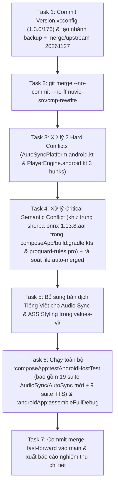

# Kế hoạch Chiến lược: Đồng bộ Commit mới nhất từ `9000000/NuvioMobile` (`21/11/2026` ➔ `27/11/2026`)

> **Mã kế hoạch**: `PLAN-merge-upstream-20261127`  
> **Trạng thái**: Chờ duyệt để thực thi (Pending Review)  
> **Người lập**: Agent mon  
> **Ngày lập**: 27/11/2026  
> **Nguồn upstream**: `https://github.com/9000000/NuvioMobile.git` (Remote: `nuvio-src`, Nhánh: `cmp-rewrite`)  
> **Nhánh đích**: `main` (Remote: `origin`, `https://github.com/9000000/NuvioMobile-Fast.git`)  
> **Điểm cơ sở (Merge Base)**: `4ec93635a` (`2026-11-24`, `bump version` — đã đồng bộ toàn bộ commit trước ngày `24/11` trong đợt `PLAN-merge-upstream-20261124`)  
> **Đỉnh upstream mới nhất**: `6d2fdab63` (`2026-11-26 20:04:45 +0300`, `Merge pull request #2732 from DavidVamaiotu/feat/audio-sync-fallback`)  
> **Quy mô thay đổi upstream**: **32 commits** (`7` first-parent commits/merges), **>90 files** (tính năng lớn **Audio Sync Fallback**, **ASS Separate Styling**, **Embedded AutoSync Speed**, **Nuvio Engine 0.1.7**, **Addon Subtitle Recomposition**, **Debrid Ampersand Fix**)

---

## 🎯 1. Mục tiêu Cốt lõi & Hiện trạng Working Tree

### Mục tiêu
1. Cập nhật đầy đủ toàn bộ **32 commit mới nhất** từ `nuvio-src/cmp-rewrite` (`4ec93635a..6d2fdab63`) vào nhánh `main` của `NuvioMobile-Fast`.
2. Giải quyết triệt để **2 file Hard Conflict** (`AutoSyncPlatform.android.kt`, `PlayerEngine.android.kt`) và xử lý triệt để **xung đột ngữ nghĩa nghiêm trọng (Critical Semantic Conflict)** do trùng lặp thư viện **`sherpa-onnx-1.13.8.aar`** giữa **Piper ONNX TTS** của Fast và **Audio Sync Fallback** của Upstream.
3. **Bảo toàn 100%** mọi tùy chỉnh độc quyền của `NuvioMobile-Fast` (TTS Offline Google Speech + Piper ONNX + Timing Sync + Phiên âm tên riêng & từ tiếng Anh, Live TV, TorrServer, Trakt OAuth PKCE, Simkl OAuth V2, IPv4FirstDns, Font `PhimMoi`/`Oswald`, range viền `1..10`, nút `+ Thêm phụ đề`, phiên bản `1.3.0` / `176`).
4. Việt hóa bổ sung các chuỗi UI mới của **Audio Sync Fallback** & **ASS Styling** vào `values-vi/` để giữ trải nghiệm tiếng Việt đồng bộ 100%.

### Hiện trạng Working Tree
- Nhánh `main` đang ở `db1b3c975` (đã đồng bộ tới `4ec93635a`).
- Working tree đang có **1 thay đổi chưa commit của bạn**:
  - `M iosApp/Configuration/Version.xcconfig`: nâng từ `1.2.9` (`175`) ➔ **`1.3.0` (`176`)** *(upstream lần này không sửa `Version.xcconfig`)*.

> [!IMPORTANT]
> **Điều kiện tiên quyết (Pre-flight Gate)**:
> - Commit sạch `iosApp/Configuration/Version.xcconfig` (`1.3.0` / `176`) trên `main`, tạo nhánh sao lưu `backup/pre-upstream-merge-20261127`, và thực hiện toàn bộ thao tác merge + kiểm thử trên nhánh làm việc riêng `merge/upstream-20261127`.

---

## 🌟 2. Tổng hợp & Đánh giá Chi tiết 7 Nhóm Thay đổi từ `nuvio-src/cmp-rewrite`

| # | Nhóm tính năng / Bản vá | PR / Commit | Tệp tiêu biểu | Phân tích & Giá trị so với code hiện tại | Quyết định |
| :-: | :--- | :--- | :--- | :--- | :--- |
| 1 | **Đồng bộ phụ đề theo Âm thanh (`Audio Sync Fallback`) — Android & iOS** | PR #2732 (`6d2fdab63`, `7f929b259`, `a49f117e9`, `d11bee1e7`...) | `features/audiosync/*` (Android/common/iOS), `silero_vad_v5_16k.bin`, `MainActivity.kt`, `SubtitleModal.kt`, `LicensesAttributionsPage.kt`, `composeApp/build.gradle.kts`, `androidApp/build.gradle.kts`, +17 file unit test | Tự động dùng Silero VAD v5 + tùy chọn Sherpa-ONNX ASR để khớp phụ đề với lời thoại âm thanh khi phim không có phụ đề nhúng; hỗ trợ tự chuyển phụ đề ứng viên khác khi không khớp. | **Chấp nhận 100%** + **Gộp dùng chung 1 file `sherpa-onnx-1.13.8.aar` cục bộ** với Piper TTS để tránh lỗi duplicate class/native lib |
| 2 | **Phục hồi Style ASS/SSA & Tách riêng Cấu hình Style cho ASS/SSA** | PR #2698 (`5f2330229`, `769bf6e74`, `0e7f9a438`, `ecfd67d72`) | `SubtitleAppearance.kt`, `SubtitleAppearanceControls.kt`, `PlayerLibassCompat.kt`, `PlayerEngine.android.kt`, `PlayerEngine.ios.kt`, `PlayerSettingsRepository.kt`, `PlayerSettingsStorage.*`, `PlayerScreenRuntimeUi.kt` | Giữ nguyên style gốc của phụ đề ASS/SSA (anime, phim có hiệu ứng), cho phép phóng/thu tỷ lệ chữ ASS (`applyAssFontScaleCompat` / `sub-scale`), và tách riêng tùy chọn *"Tùy chỉnh kiểu ASS"* + lưu độc lập `assSubtitleStyle`. | **Chấp nhận 100%** *(tốt hơn hẳn; hợp nhất giữ nguyên logic "Ẩn phụ đề khi TTS đọc" trên libmpv & font `PhimMoi`/`Oswald` + range viền `1..10`)* |
| 3 | **Tăng tốc & Cải thiện độ chính xác AutoSync phụ đề nhúng** | PR #2779 (`4777b31a1`, `825355a65`) | `AutoSyncPlatform.android.kt` (**CONFLICT #1**), `AutoSyncPlayerCoordinator.android.kt`, `AutoSyncLibmpvCoordinator.android.kt`, `PlayerPlaybackNetworking.kt`, +2 test suites | Port tối ưu từ NuvioTV: chia sẻ `PlayerPlaybackNetworking.playbackHttpClient` đã ấm (có sẵn `IPv4FirstDns` + `NetworkErrorInterceptor` + HTTP/2), đồng bộ phụ đề nhúng nhanh gấp nhiều lần. | **Chấp nhận & Thay thế bản cũ** ở `AutoSyncPlatform.android.kt` *(code mới vượt trội và vẫn giữ trọn `IPv4FirstDns` + `NetworkErrorInterceptor`)* |
| 4 | **Cập nhật Nuvio P2P Engine lên `0.1.7`** | `8f19c9d53` | `composeApp/libs/lib-nuvio-engine-android-0.1.6.aar` ➔ `0.1.7.aar` | Nâng cấp thư viện P2P Engine Android từ `0.1.6` ➔ `0.1.7` (`composeApp/build.gradle.kts` tự động nạp theo `lib-*.aar`). | **Chấp nhận 100%** |
| 5 | **Sửa lỗi Recomposition & Tự chọn Phụ đề Addon khi đến muộn** | PR #2734 (`0d20af832`, `29567e386`, `5ff7a4e66`, `7c8b66b30`) | `PlayerScreenRuntimeState.kt`, `PlayerScreenRuntimeEffects.kt`, `PlayerScreenRuntimeUi.kt` | Đổi state phụ đề addon sang `mutableStateOf` tránh thừa recomposition, không chặn phụ đề addon khi sync backend lỗi, tự chọn phụ đề ưu tiên khi addon trả về sau lúc video đã chạy. | **Chấp nhận 100%** *(sửa bug thực tế rất đáng giá)* |
| 6 | **Khớp tên tệp Debrid chứa ký tự `&`** | PR #2768 (`fb17f6574`, `6f5a492df`) | Tệp xử lý tên tệp Debrid + test | Khắc phục lỗi không khớp file trong torrent Debrid khi tiêu đề có dấu `&` vs `and`. | **Chấp nhận 100%** |
| 7 | **Cập nhật `store-beta.json` (`1.1.0-beta.3`)** | `bd9506cc8` | `store-beta.json` | Thêm bản ghi `1.1.0-beta.3` vào kênh beta upstream. | **Chấp nhận** (kiểm tra JSON hợp lệ) |

---

## 💥 3. Phân tích Chuyên sâu: 2 Hard Conflicts & 2 Critical Semantic Conflicts

### 🚨 CRITICAL SEMANTIC CONFLICT #1 (Sẽ làm GÃY BUILD nếu không xử lý!): `composeApp/build.gradle.kts` — Trùng lặp `sherpa-onnx-1.13.8.aar`
> [!CAUTION]
> **Phát hiện cực kỳ quan trọng từ kiểm tra SHA-256**:
> - `NuvioMobile-Fast` đã có sẵn **`composeApp/libs/sherpa-onnx-1.13.8.aar`** (cho Piper ONNX TTS) với SHA-256 = `633C24321E06B1FE79FEAFA03EA16CBC0F8A286641E2DA3559BAC91BDB13BD96`.
> - Upstream `PR #2732` (Audio Sync) thêm task `downloadAudioSyncRuntime` tải về **CHÍNH XÁC CÙNG FILE `sherpa-onnx-1.13.8.aar`** với SHA-256 = `633c24321e06b1fe79feafa03ea16cbc0f8a286641e2da3559bac91bdb13bd96` (trùng khớp **100% bit-for-bit**) và khai báo thêm `implementation(files(sherpaOnnxAar).builtBy(downloadAudioSyncRuntime))`!
> - **Hậu quả nếu để auto-merge nguyên trạng**: Cả hai dòng `implementation(...)` cùng tồn tại trong `androidMain` ➔ **LỖI DUPLICATE CLASSES (`com.k2fsa.sherpa.onnx.*`) & DUPLICATE `.so` NATIVE LIBS ngay lập tức!**
> - **Phương án xử lý tối ưu**:
>   1. Trong `composeApp/build.gradle.kts`: **chỉ giữ duy nhất 1 dependency cục bộ** `implementation(files("libs/sherpa-onnx-1.13.8.aar"))` để cả **Piper ONNX TTS** và **Audio Sync Fallback** dùng chung (nhanh hơn, không cần tải lại từ GitHub khi clean build, không bao giờ duplicate). Gỡ bỏ dòng `implementation(files(sherpaOnnxAar)...)` và task `DownloadAudioSyncRuntimeTask` thừa.
>   2. Trong `androidApp/build.gradle.kts`: **giữ** dòng `excludes += listOf("lib/*/libsherpa-onnx-c-api.so", "lib/*/libsherpa-onnx-cxx-api.so")` của upstream — cả Piper TTS (`OfflineTts`) lẫn Audio Sync (`OfflineRecognizer`) đều dùng JNI (`libsherpa-onnx-jni.so`), loại bỏ 2 file C/C++ API trùng giúp **giảm đáng kể dung lượng APK**!
>   3. Trong `composeApp/proguard-rules.pro`: gộp gọn 2 dòng `-keep com.k2fsa.sherpa.onnx.**` bị trùng lặp thành 1 khối duy nhất dùng chung cho cả Piper TTS & Audio Sync.

---

### 🔴 Hard Conflict #1: `composeApp/src/androidMain/kotlin/com/nuvio/app/features/autosync/AutoSyncPlatform.android.kt`
- **Local (`HEAD`)**: Tạo mới `OkHttpClient.Builder().dns(IPv4FirstDns())...addInterceptor(NetworkErrorInterceptor()).build()`.
- **Upstream (`PR #2779`)**: Dùng `PlayerPlaybackNetworking.playbackHttpClient.newBuilder()` (tái sử dụng connection pool đã ấm, dispatcher, HTTP/2 + HTTP/1.1, self-signed SSL fallback).
- **Đối chiếu thực tế**: Đã kiểm tra `PlayerPlaybackNetworking.kt` dòng 48–62 trên `HEAD`: `playbackHttpClient` **ĐÃ CÓ SẴN** cả `.dns(IPv4FirstDns())` lẫn `.addInterceptor(NetworkErrorInterceptor())`!
- **Phương án giải quyết (Thay thế bằng code mới vượt trội)**: Chấp nhận bản của Upstream (`PlayerPlaybackNetworking.playbackHttpClient.newBuilder()`). Vừa giữ trọn `IPv4FirstDns` + `NetworkErrorInterceptor`, vừa hưởng trọn tối ưu warm connection pool của PR #2779.

---

### 🔴 Hard Conflict #2: `composeApp/src/androidMain/kotlin/com/nuvio/app/features/player/PlayerEngine.android.kt` (3 Hunks)
1. **Hunk 1 (dòng ~80 — imports)**:
   - Giữ **cả hai**: `import com.nuvio.app.features.addons.httpGetTextWithHeaders` (của TTS) VÀ 4 import `com.nuvio.app.features.audiosync.{AudioSyncFallback, AudioSyncSettings, AudioSyncTaps, MpvAudioSyncHost}` (của Upstream).
2. **Hunk 2 (dòng ~381 — Extractor factory wrapping cho ExoPlayer)**:
   - Hợp nhất thông minh (tránh chạy `AudioSyncTaps` thừa khi chỉ bật TTS, không có overhead):
     ```kotlin
     SubtitleTtsCoordinator.ensureLoaded()
     val autoSyncOnStart = AutoSyncPreferencesRepository.preferredSubtitleAutoSyncOnStart.value
     val ttsEnabled = SubtitleTtsCoordinator.settings.value.enabled
     if (autoSyncOnStart || ttsEnabled) {
         val audioDelegate = if (autoSyncOnStart && AudioSyncSettings.fallbackEnabled.value) {
             AudioSyncFallback.initialize(context)
             AudioSyncTaps.wrapExtractors(factory, sourceUrl)
         } else {
             factory
         }
         AutoSyncExtractorsFactory(audioDelegate, sourceUrl)
     } else {
         factory
     }
     ```
3. **Hunk 3 (dòng ~1965 — `NuvioLibmpvView` fields & `updateStyledSubtitle()`)**:
   - Giữ **toàn bộ fields & `disposeExternalTimelines()`** của Fast (`currentPlayerVolume`, `currentAmplificationDb`, `timelineScope`, `cachedExternalTimelines`, `inFlightExternalTimelines`) **VÀ** toàn bộ `appliedAssOverride`/`appliedAssScale`/`appliedAssBold`/`appliedSubPos` của Upstream.
   - Trong `updateStyledSubtitle()`: chạy đầy đủ logic cấu hình ASS của PR #2698 (`sub-ass-override`, `sub-scale`, `sub-pos`, `sub-ass-style-overrides`), rồi kết hợp với cờ ẩn phụ đề của TTS:
     ```kotlin
     val ttsSettings = SubtitleTtsCoordinator.settings.value
     val hideVisual = ttsSettings.shouldHideVisualSubtitles
     val styled = style.usesStyledOverlay && SubtitleRendering.supportsTextOverlay(codec)
     val suppressMpvNativeSub = styled || hideVisual
     if (suppressMpvNativeSub != styledSubtitleVisible) {
         mpv.setPropertyBoolean("sub-visibility", !suppressMpvNativeSub)
         styledSubtitleVisible = suppressMpvNativeSub
     }
     ```
   - Đảm bảo tính năng **"Ẩn phụ đề khi TTS đọc"** hoạt động hoàn hảo trên cả phụ đề SRT lẫn ASS trong libmpv.

---

### 🟡 Rà soát 21 File Auto-Merged Giao nhau khác
Các file giao nhau trọng yếu cần kiểm chứng kỹ sau auto-merge:
- `SubtitleAppearance.kt`: giữ `BuiltInSubtitleFonts = listOf("default", "phimmoi", "oswald", "sans", "serif", "mono")`, đồng thời có `customizeAss`, `decodeAssSubtitleStyle`, `encodeAssStyle`, `SubtitleRendering.assOverride`.
- `SubtitleAppearanceControls.kt`: giữ `subtitleOutlineWidthRange` (`1..10`), đồng thời có công tắc `subtitle_customize_ass`.
- `SubtitleModal.kt`: giữ nút `+ Thêm phụ đề` (`SubtitleImportRow`) + `SubtitleFormatChip`, đồng thời có `AutoSyncStatusIndicator` và tham số `supportsAssStyleCustomization`.
- `PlayerScreenRuntimeUi.kt`, `PlayerScreenModalHosts.kt`, `PlayerScreenRuntimeEffects.kt`, `PlayerScreenRuntimeState.kt`: giữ nguyên nút & modal `SubtitleTtsModal`, Live TV panel (`PlayerLiveChannelsPanel`), và nhận đủ logic `activeSubtitleStyle` / `isAssSubtitleStyleActive` + sửa recomposition addon subtitles.
- `PlayerSettingsRepository.kt`, `PlayerSettingsStorage.kt` / `.android.kt` / `.ios.kt`: giữ nguyên mọi cài đặt Fast + bổ sung `assSubtitleStyle`.
- `MainActivity.kt`: giữ nguyên khởi tạo Fast (Live TV, TTS, TorrServer...) + thêm `AudioSyncFallback.initialize(applicationContext)`.
- `PlayerEngine.ios.kt`: giữ hook `SubtitleTtsCoordinator.onSubtitleCueChanged(...)` + nhận `supportsAssStyleCustomization`, `rendersAssNatively`, `createIosAudioSyncFallback`.
- **Việt hóa bổ sung (`values-vi/`)**: bổ sung bản dịch tiếng Việt tự nhiên cho `values-vi/audio_sync_strings.xml` (23 chuỗi mới), cập nhật 7 chuỗi trạng thái mới trong `values-vi/autosync_toast_strings.xml`, và thêm `subtitle_customize_ass` vào `values-vi/strings.xml` để giao diện tiếng Việt đầy đủ 100%.

---

## 🛡️ 4. Xác nhận Bảo toàn 100% Tùy chỉnh Độc quyền của NuvioMobile-Fast

> [!NOTE]
> Đối chiếu toàn bộ danh sách file upstream thay đổi:
> - **0% đụng chạm** vào toàn bộ thư mục **TTS Offline & Phiên âm tên riêng tiếng Anh** (`features/player/tts/*`, `tts_en_vi_dict.tsv`, `PlaybackAudioTtsSettings.kt`, `SettingsSearch.kt`, `AndroidManifest.xml` `<queries>`).
> - **0% đụng chạm** vào **Live TV** (`features/livetv/*`), **TorrServer** (`features/torrserver/*`), **Trakt OAuth PKCE**, **Simkl OAuth V2**, **Font `Oswald`/`PhimMoi`**, **`iosApp/Configuration/Version.xcconfig`** (`1.3.0` / `176`), **Fast Build ABI Splits & Release Scripts**.

---

## 🗺️ 5. Luồng Thực thi (Execution Flow)



---

## 📋 6. Phân rã Task Triển khai

### 🔹 Task 1 (`TASK-SYNC-261127-01`): Chốt `Version.xcconfig` (`1.3.0` / `176`) & Tạo Nhánh An toàn
**Phụ trách**: `git-specialist`
- [ ] Commit `iosApp/Configuration/Version.xcconfig` (`1.3.0` / `176`) và tài liệu plan lên `main`.
- [ ] Tạo nhánh sao lưu `backup/pre-upstream-merge-20261127` và chuyển sang nhánh `merge/upstream-20261127`.

### 🔹 Task 2 (`TASK-SYNC-261127-02`): Thực thi Merge & Giải quyết 2 Hard Conflicts
**Phụ trách**: `backend-specialist`
- [ ] Chạy `git merge --no-commit --no-ff nuvio-src/cmp-rewrite`.
- [ ] Giải quyết `AutoSyncPlatform.android.kt`: chấp nhận `PlayerPlaybackNetworking.playbackHttpClient.newBuilder()` (đã tích hợp sẵn `IPv4FirstDns` + `NetworkErrorInterceptor` + warm pool).
- [ ] Giải quyết 3 hunks trong `PlayerEngine.android.kt`: giữ đủ import, hợp nhất `AutoSyncExtractorsFactory` + `AudioSyncTaps` không gây overhead khi chỉ bật TTS, và hợp nhất `updateStyledSubtitle()` giữ cả ASS styling mới lẫn cờ `hideVisual` của TTS.

### 🔹 Task 3 (`TASK-SYNC-261127-03`): Khử trùng `sherpa-onnx-1.13.8.aar` & Rà soát File Auto-Merged
**Phụ trách**: `backend-specialist` / `quality-inspector`
- [ ] Chỉnh `composeApp/build.gradle.kts`: bỏ dòng trùng `implementation(files(sherpaOnnxAar).builtBy(downloadAudioSyncRuntime))` và task `DownloadAudioSyncRuntimeTask`, dùng chung 1 file cục bộ `implementation(files("libs/sherpa-onnx-1.13.8.aar"))` (SHA-256 khớp 100%) cho cả Piper TTS & Audio Sync.
- [ ] Gọn hóa `composeApp/proguard-rules.pro` (xóa 2 dòng `-keep com.k2fsa.sherpa.onnx.**` bị lặp ở cuối).
- [ ] Kiểm tra `androidApp/build.gradle.kts` (giữ ABI splits + dòng `excludes` `c-api`/`cxx-api`), `SubtitleAppearance.kt` (`phimmoi`, `oswald`), `SubtitleAppearanceControls.kt`, `SubtitleModal.kt`, `PlayerScreenRuntimeUi.kt`, `PlayerEngine.ios.kt`, `MainActivity.kt`, và `store-beta.json`.

### 🔹 Task 4 (`TASK-SYNC-261127-04`): Bổ sung Việt hóa cho Audio Sync Fallback & ASS Styling
**Phụ trách**: `frontend-specialist`
- [ ] Tạo `composeApp/src/commonMain/composeResources/values-vi/audio_sync_strings.xml` dịch đầy đủ 23 chuỗi của Audio Sync Fallback sang tiếng Việt tự nhiên.
- [ ] Cập nhật `composeApp/src/commonMain/composeResources/values-vi/autosync_toast_strings.xml` bổ sung 7 chuỗi trạng thái mới (`autosync_status_*`).
- [ ] Thêm chuỗi `subtitle_customize_ass` vào `composeApp/src/commonMain/composeResources/values-vi/strings.xml` và xác minh XML `0` duplicate keys.

### 🔹 Task 5 (`TASK-SYNC-261127-05`): Kiểm thử Toàn diện & Biên dịch Android Full Debug
**Phụ trách**: `test-engineer`
- [ ] Chạy toàn bộ test suite (bao gồm **~19 suite mới** của AudioSync/AutoSync/PlayerSubtitleRestore + **9 suite TTS** + toàn bộ suite hiện có):
  ```powershell
  .\gradlew.bat :composeApp:testAndroidHostTest "-Pnuvio.android.distribution=full" --console=plain
  ```
  Kỳ vọng: **100% PASS (0 failures, 0 errors)**.
- [ ] Biên dịch & đóng gói Android Full Debug (xác minh không lỗi duplicate classes/native libs từ `sherpa-onnx`, tương thích `lib-nuvio-engine-android-0.1.7.aar`, đóng gói cả `tts_en_vi_dict.tsv` & `silero_vad_v5_16k.bin`):
  ```powershell
  .\gradlew.bat :androidApp:assembleFullDebug "-Pnuvio.android.distribution=full" --console=plain
  ```
  Kỳ vọng: **`BUILD SUCCESSFUL`**.

### 🔹 Task 6 (`TASK-SYNC-261127-06`): Hoàn tất Merge vào `main` & Báo cáo Nghiệm thu Chi tiết
**Phụ trách**: `orchestrator`
- [ ] Commit merge chuẩn hóa trên `merge/upstream-20261127`:
  `Merge nuvio-src/cmp-rewrite (24/11/2026 - 26/11/2026, 32 commits -> 6d2fdab63)`
- [ ] Fast-forward vào `main`, cập nhật `task.md` và `PLAN-merge-upstream-20261127.md`.
- [ ] Xuất báo cáo nghiệm thu chi tiết mọi thay đổi đã nhận, xung đột đã xử lý và xác nhận bảo toàn tùy chỉnh.

---

## ⚠️ 7. Ma trận Rủi ro & Biện pháp Kiểm soát

| Rủi ro | Mức độ | Biện pháp kiểm soát |
| :--- | :---: | :--- |
| **Duplicate classes / `.so` từ 2 nguồn `sherpa-onnx-1.13.8.aar`** | **Rất Cao** | Đã phát hiện trước khi merge; hợp nhất dùng chung 1 file cục bộ `composeApp/libs/sherpa-onnx-1.13.8.aar` (SHA-256 trùng 100%) và xác minh qua `assembleFullDebug`. |
| **Mất tính năng "Ẩn phụ đề khi TTS đọc" trên libmpv sau PR #2698** | Cao | Hợp nhất trực tiếp `suppressMpvNativeSub = styled || hideVisual` vào `updateStyledSubtitle()` trong `PlayerEngine.android.kt`. |
| **Overhead `AudioSyncTaps` chạy khi chỉ bật TTS** | Trung bình | Ràng buộc `AudioSyncTaps.wrapExtractors` chỉ chạy khi `autoSyncOnStart && AudioSyncSettings.fallbackEnabled.value`. |
| **Hỏng `libsherpa-onnx-jni.so` khi exclude `c-api`/`cxx-api`** | Thấp | Xác minh `libsherpa-onnx-jni.so` & `libonnxruntime.so` còn đầy đủ trong APK output; kiểm chứng trên máy thật với cả Piper TTS & Audio Sync. |
