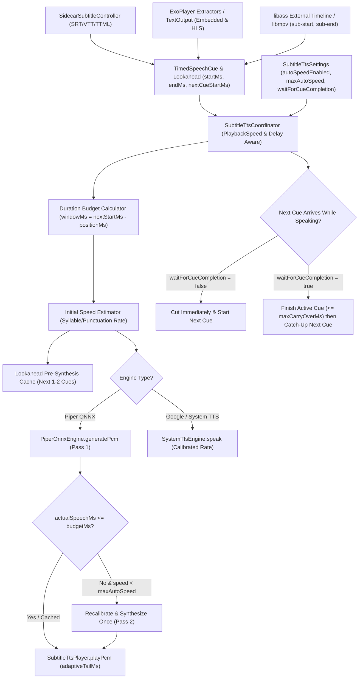

# Kế hoạch Chiến lược: Căn Nhịp TTS Theo Thời Gian Phụ Đề (Đọc Trọn Câu, Đúng Nhịp Phim)

> **Mã kế hoạch**: `PLAN-subtitle-tts-timing-sync`  
> **Trạng thái**: Sẵn sàng thực thi (Pending Execution)  
> **Người lập**: Agent mon  
> **Ngày lập**: 20/11/2026  

---

## 🎯 1. Mục tiêu Cốt lõi & Hiện trạng Vấn đề

### Nguyên nhân gốc rễ hiện tại
1. **Thiếu hoàn toàn thông tin thời gian (`timing`) khi kích hoạt TTS**:
   - `SubtitleCuePresenter.present(...)` và `MpvSurfaceView.updateStyledSubtitle()` hiện chỉ truyền mỗi chuỗi văn bản (`rawText: String`) vào `SubtitleTtsCoordinator.onSubtitleCueTextChanged(rawText)`.
   - `SubtitleTtsTextCleaner.calculateEffectiveSpeed(...)` chỉ ước lượng tốc độ dựa trên **số ký tự** (`<=30`, `<=60`, `<=90`, `>90`), hoàn toàn không biết câu phụ đề đó chỉ được phép tồn tại **1.4 giây** hay có tới **5.0 giây** trước khi câu kế tiếp xuất hiện.
2. **Độ trễ khởi tạo suy luận ONNX + Đệm tĩnh làm hụt quỹ thời gian**:
   - Đúng thời điểm câu mới xuất hiện mới chạy `PiperOnnxEngine.generatePcm(...)`, mất ~120–300ms chờ CPU suy luận rồi mới phát ra loa.
   - `SubtitleTtsPlayer.android.kt` đang đệm cứng `tailMs = 450ms` im lặng ở mọi câu; với các câu nối sát nhau, 450ms đó chiếm chỗ làm câu sau vào trễ hoặc câu trước dễ chạm mốc câu kế.
3. **Ngắt ngang tuyệt đối khi đổi câu**:
   - Ngay khi câu mới xuất hiện, `onSubtitleCueTextChanged` gọi `speakJob?.cancel(); player.stop()` lập tức cắt ngang phần cuối câu đang đọc.

### Mục tiêu cần đạt
1. **Đọc gọn, trọn vẹn từng câu trong đúng khung thời gian của file phụ đề**:
   - Truyền trực tiếp mốc thời gian `startMs`, `endMs`, `nextCueStartMs` (tính từ timeline phụ đề thực tế + bù `subtitleDelayMs` + chia theo `playbackSpeed` của video) sang `SubtitleTtsCoordinator`.
   - Cho phép ép tăng tốc linh hoạt lên tới **`2.0x` – `2.2x`** (theo mức trần cấu hình `maxAutoSpeed`) dựa trên thời gian thực còn lại cho câu đó, đảm bảo không bị đọc tràn sang câu tiếp theo.
2. **Khớp thực đo 100% với PCM của Piper AI + Tiền tổng hợp câu kế tiếp (Lookahead)**:
   - Tận dụng việc Piper AI trả về mảng `FloatArray` PCM (biết chính xác `actualSpeechMs = samples.size * 1000 / sampleRate` trước khi phát): nếu tốc độ ước lượng ban đầu cho ra audio vẫn dài hơn quỹ thời gian cho phép, tự động tính hệ số hiệu chỉnh và tổng hợp lại tối đa 1 lần để vừa khít slot.
   - Khi đang phát câu hiện tại, chạy nền **tiền tổng hợp (pre-synthesize) 1–2 câu sắp tới** trong cache bộ nhớ nhỏ để loại bỏ ~150–300ms trễ ONNX ở thời điểm đổi câu.
3. **Hỗ trợ đầy đủ tùy chọn người dùng trong Cài đặt & Bảng TTS trong Player**:
   - Nâng cấp công tắc hiện có thành **"Tự động căn nhịp theo thời gian phụ đề"**.
   - Thêm thanh trượt **"Tốc độ tối đa khi bắt nhịp"** (`1.4x` – `2.2x`, mặc định `2.1x`).
   - Thêm công tắc **"Chờ đọc hết câu trước khi chuyển"** (mặc định Tắt để ưu tiên khớp đúng nhịp cảnh phim; khi Bật sẽ cho phép đọc nốt câu cũ trong ngưỡng bảo vệ rồi tăng tốc bắt kịp câu kế).

---

## ⚠️ 2. Phân tích Rủi ro & Điểm Cần Lưu ý

> [!IMPORTANT]
> **Phạm vi dữ liệu thời gian theo từng nguồn phụ đề (4 luồng)**:
> - **Phụ đề rời / Addon qua `SidecarSubtitleController`** (SRT, VTT, TTML, SSA không dùng libass): Có sẵn **100% timeline** trong `sidecarTimedCues: List<CuesWithTiming>`. Lấy được chính xác `cueStartUs`, `cueEndUs`, `nextCueStartUs` (bỏ qua cue SDH/trống) và danh sách 1–2 câu sắp tới để tiền tổng hợp.
> - **Phụ đề `.ass` / `.ssa` qua `libass` (`AssHandler`)**: Phụ đề addon `.ass` có thể được parse thêm song song bằng `PlayerSubtitleCueParser.parse(...)` ở dạng lightweight timeline chỉ để phục vụ TTS mà không can thiệp vào luồng render đồ họa của `libass`.
> - **Phụ đề nhúng trong container ExoPlayer (`MKV`, `MP4`)**: Khi TTS bật, tái sử dụng cơ chế quan sát sample trong buffer extractor (`ObservingTextTrackOutput` / `EmbeddedSubtitleCueStore`) để lấy `startTimeUs`, `endTimeUs` của các câu đã nạp sẵn trong buffer; trường hợp stream live/HLS chỉ có `CueGroup.presentationTimeUs` (không biết trước `nextCueStartMs`), tự động lùi an toàn về công thức ước lượng theo độ dài câu kết hợp `maxAutoSpeed`.
> - **Trình phát `libmpv` (Android & iOS)**: Đọc trực tiếp thuộc tính `sub-start`, `sub-end`, `speed`, `sub-delay` từ MPV khi `sub-text` thay đổi; với phụ đề ngoài (`currentExternalSubtitles`), kết hợp timeline đã parse để biết `nextCueStartMs`.

> [!WARNING]
> **Rủi ro hiệu năng CPU & Tránh vòng lặp tổng hợp vô tận**:
> - Việc **khớp thực đo 2 pha (2-Pass Duration Calibration)** chỉ được phép chạy tối đa **1 lần tổng hợp lại** cho mỗi câu (nếu vẫn vượt thời gian sau khi đã chạm trần `maxAutoSpeed` thì phát thẳng, tuyệt đối không lặp nhiều lần gây nghẽn `piperMutex`).
> - Tốc độ quá cao (`> 2.2x`) có thể làm biến dạng phát âm VITS của Piper hoặc khiến Android `TextToSpeech` không phản hồi kịp trên một số máy OEM; cần khóa cứng biên an toàn (`0.7x .. 2.2x` cho UI/coordinator, `<= 2.5f` ở tầng engine).
> - Khi **Tua phim (`onSeek`)**, **Tạm dừng (`onPlaybackPaused`)**, hoặc **Đổi giọng/Tắt TTS**, phải hủy toàn bộ tác vụ `lookahead`, xóa sạch cache tiền tổng hợp và hàng đợi chờ đọc (`pendingNextCue`) để tránh phát nhầm câu cũ.

> [!NOTE]
> **Tương thích `tailMs` với sửa lỗi "hụt hơi cuối câu" trước đó**:
> - Không xóa bỏ phần đệm `leadMs = 40ms` và `fadeOutMs = 12ms` mới thêm ở `SubtitleTtsPlayer.android.kt` (đây là lớp bảo vệ âm cuối không bị cụt/bộp).
> - Thay vì cố định `tailMs = 450ms`, biến `tailMs` thành **tham số động (`adaptiveTailMs`)**: nếu khoảng trống trước câu kế tiếp rộng (`>= 450ms`) giữ nguyên `350ms–450ms` để tiếng ngân tự nhiên; nếu hai câu nối sát nút nhau (`nextGapMs < 350ms`), co gọn `tailMs` xuống `40ms–80ms` để dành trọn thời gian cho lời thoại và phát câu tiếp theo đúng nhịp.

---

## 🗺️ 3. Chuỗi Phụ thuộc & Luồng Xử lý (Architecture & Dependency Chain)

---

## 📋 4. Kế hoạch Triển khai Theo Giai đoạn (Phase-by-Phase Breakdown)

### 🔹 Giai đoạn 1: Mở rộng Mô hình Dữ liệu, Cấu hình & Lưu trữ (`Models & Storage`)
- **Tệp chỉnh sửa**:
  - `composeApp/src/commonMain/kotlin/com/nuvio/app/features/player/tts/SubtitleTtsModels.kt`
  - `composeApp/src/commonMain/kotlin/com/nuvio/app/features/player/tts/SubtitleTtsStorage.kt`
  - `composeApp/src/androidMain/kotlin/com/nuvio/app/features/player/tts/SubtitleTtsStorage.android.kt`
  - `composeApp/src/iosMain/kotlin/com/nuvio/app/features/player/tts/SubtitleTtsStorage.ios.kt`
- **Chi tiết thực hiện**:
  1. Tạo các kiểu dữ liệu thời gian chuẩn trong `SubtitleTtsModels.kt`:
     - `TimedSpeechCue(val rawText: String, val startMs: Long, val endMs: Long?, val nextCueStartMs: Long?)`
     - `SubtitleCuePlaybackContext(val currentCue: TimedSpeechCue, val upcomingCues: List<TimedSpeechCue>, val playbackSpeed: Float)`
  2. Bổ sung vào `SubtitleTtsSettings`:
     - Giữ nguyên `autoSpeedEnabled: Boolean = true` (đảm bảo không mất cấu hình người dùng cũ).
     - Thêm `maxAutoSpeed: Float = 2.1f` (phạm vi cho phép `1.4f..2.2f`).
     - Thêm `waitForCueCompletion: Boolean = false` (mặc định tắt theo lựa chọn ưu tiên gọn trong slot; bật để chờ đọc hết câu rồi nối câu).
  3. Cập nhật `SubtitleTtsStorage.android.kt` và `SubtitleTtsStorage.ios.kt` để đọc/ghi 2 trường mới bằng `ProfileScopedKey`.

### 🔹 Giai đoạn 2: Bộ Tính Toán Quỹ Thời Gian & Tốc Độ Thực Đo (`Timing Budget & Calibration`)
- **Tệp chỉnh sửa / tạo mới**:
  - `composeApp/src/commonMain/kotlin/com/nuvio/app/features/player/tts/SubtitleTtsTextCleaner.kt`
  - Tạo mới (gọn nhẹ): `composeApp/src/commonMain/kotlin/com/nuvio/app/features/player/tts/SubtitleTtsTimingCalculator.kt` (tách thuần hàm logic để test 100% trên JVM host test).
- **Chi tiết thực hiện**:
  1. **Tính quỹ thời gian khả dụng (`resolveSpeechBudgetMs`)**:
     - Tính thời điểm mốc kết thúc slot: ưu tiên `nextCueStartMs` (nếu có và lớn hơn `startMs`); fallback về `endMs`; nếu cả hai đều thiếu (stream live không index) thì trả về `null` để lùi về ước lượng độ dài câu.
     - Trừ thời gian đã trôi qua nếu cue vừa nhảy vào muộn (`(currentPositionMs - startMs).coerceAtLeast(0L)`), chia cho `playbackSpeed`, rồi trừ `safetyBreathMarginMs` (`60ms–90ms`) nhằm giữ một khoảng thở cực nhỏ trước câu sau.
     - Hỗ trợ trường hợp câu hiện tại ngắn nhưng khoảng im lặng phía sau còn dài: chỉ cần đọc xong trước `nextCueStartMs`, không cần ép đọc quá nhanh nếu `endMs` ngắn nhưng `nextCueStartMs` còn xa.
  2. **Bộ ước lượng tốc độ khởi điểm (`estimateInitialSpeed`)**:
     - Thay cho bảng mốc 4 bậc cứng (`30/60/90`), ước lượng thời gian đọc ở tốc độ `1.0x` dựa trên số từ / âm tiết (`wordCount`), mật độ dấu ngắt (`comma/period pause`) và hằng số tốc độ trung bình của tiếng Việt (~210–250ms/âm tiết tùy engine).
     - Tính `targetSpeed = baseSpeed * (estimatedAtBaseMs / budgetMs)` kẹp trong `[baseSpeed, maxAutoSpeed]`.
  3. **Hiệu chỉnh 2 pha với PCM thật (`computeRecalibratedSpeed`)**:
     - Sau khi Piper sinh xong `samples`, đo `actualSpeechMs = (samples.size * 1000L) / sampleRate`.
     - Nếu `actualSpeechMs > budgetMs + toleranceMs` (ví dụ `> +70ms`) và `usedSpeed < maxAutoSpeed`, tính `newSpeed = (usedSpeed * (actualSpeechMs.toFloat() / budgetMs)).coerceIn(usedSpeed + 0.05f, maxAutoSpeed)`.
  4. **Tính `adaptiveTailMs` động**:
     - Nếu còn dư nhiều thời gian sau khi đọc xong (`remainingTailMs >= 400ms`) giữ `tailMs = 400ms`; nếu sát giờ sang câu mới giữ `tailMs = 45ms..80ms`.

### 🔹 Giai đoạn 3: Thu thập Timeline Phụ Đề từ 4 Nguồn Trong Player
- **Tệp chỉnh sửa**:
  - `composeApp/src/androidMain/kotlin/com/nuvio/app/features/player/SubtitleCuePresenter.kt`
  - `composeApp/src/androidMain/kotlin/com/nuvio/app/features/player/PlayerSidecarSubtitles.kt`
  - `composeApp/src/androidMain/kotlin/com/nuvio/app/features/player/PlayerEngine.android.kt`
  - `composeApp/src/iosMain/kotlin/com/nuvio/app/features/player/PlayerEngine.ios.kt`
  - `composeApp/src/androidMain/kotlin/com/nuvio/app/features/autosync/AutoSyncExtractorsFactory.kt` (chỉ hook đọc nhẹ metadata khi cần hoặc dùng chung store với điều kiện không làm nặng playback khi TTS tắt)
- **Chi tiết thực hiện**:
  1. **`SubtitleCuePresenter`**: Mở rộng `present(cues, canStyle, timingContext: SubtitleCuePlaybackContext? = null)` (giữ tương thích ngược gọi mặc định không cần `timingContext` cho unit test hiện có `SubtitleCuePresenterTest`).
  2. **`SidecarSubtitleController`**:
     - Viết hàm tìm kiếm O(1) theo vị trí con trỏ `sidecarCursorNextIndex` để trích xuất: `currentStartMs`, `currentEndMs`, `nextNonBlankCueStartMs` (tìm tiếp qua các entry kế mà sau khi `SubtitleTtsTextCleaner.clean(...)` khác rỗng và khác nội dung đang phát), cùng tối đa **2 câu kế tiếp (`lookahead`)**.
     - Điều chỉnh toàn bộ timestamp theo `subtitleDelayMs` và `audioDelayUs` đang áp dụng trên màn hình.
  3. **ExoPlayer Embedded / ASS / Libass**:
     - Với addon `.ass`/`.ssa` mở qua `setSubtitleUri`: parse sẵn danh sách `SubtitleSyncCue` từ file phụ đề (hoặc hook qua `CueNormalizingTextOutput` + `EmbeddedSubtitleCueStore` cho MKV/MP4 khi TTS đang bật) và tính `playbackSpeed = exoPlayer.playbackParameters.speed`.
     - Trường hợp `libass` render trực tiếp mà `TextOutput` không nhận cue, cung cấp bộ phát hiện chuyển câu theo vị trí phát `currentPosition` từ danh sách `SubtitleSyncCue` của `.ass` khi TTS đang bật.
  4. **`libmpv` (Android & iOS)**:
     - Trong `MpvSurfaceView.updateStyledSubtitle()`: đọc thêm `sub-start`, `sub-end`, `speed` (`subEnd > subStart`) và tra cứu danh sách phụ đề ngoài (nếu có) để lấy `nextCueStartMs`.
     - Trên iOS (`PlayerEngine.ios.kt`), giữ tương thích gọi `onSubtitleCueChanged(...)` kèm `playbackSpeed` hoặc parsed cues nếu là sidecar.

### 🔹 Giai đoạn 4: Nâng cấp `SubtitleTtsCoordinator`, `PiperOnnxEngine`, `SystemTtsEngine` & `SubtitleTtsPlayer`
- **Tệp chỉnh sửa**:
  - `composeApp/src/commonMain/kotlin/com/nuvio/app/features/player/tts/SubtitleTtsCoordinator.kt`
  - `composeApp/src/commonMain/kotlin/com/nuvio/app/features/player/tts/SubtitleTtsPlayer.kt`
  - `composeApp/src/androidMain/kotlin/com/nuvio/app/features/player/tts/SubtitleTtsPlayer.android.kt`
  - `composeApp/src/iosMain/kotlin/com/nuvio/app/features/player/tts/SubtitleTtsPlayer.ios.kt`
  - `composeApp/src/androidMain/kotlin/com/nuvio/app/features/player/tts/SystemTtsEngine.android.kt`
  - `composeApp/src/iosMain/kotlin/com/nuvio/app/features/player/tts/SystemTtsEngine.ios.kt`
- **Chi tiết thực hiện**:
  1. **`SubtitleTtsPlayer`**:
     - Thêm tham số `tailMs: Int = 450` (và `onCompleted: (() -> Unit)? = null` hoặc `CompletableDeferred`) cho `playPcm(...)` để hỗ trợ đệm động và báo đúng thời điểm phát xong câu.
     - Cập nhật `SubtitleTtsPlayer.ios.kt` đồng bộ chữ ký `expect/actual`.
  2. **`SystemTtsEngine`**:
     - Nâng giới hạn `setSpeechRate` từ `2.0f` lên `2.5f` ở `SystemTtsEngine.android.kt` để khớp dải `maxAutoSpeed` (`1.4x..2.2x`).
     - Gắn `UtteranceProgressListener` (báo `onDone`/`onError`) phục vụ chế độ `waitForCueCompletion = true`.
  3. **`SubtitleTtsCoordinator`**:
     - Tích hợp **Lookahead Pre-Synthesis Cache** (LRU tối đa 4 mục theo khóa `(modelId, cleanedSpeechText, quantizedSpeed)`): ngay sau khi bắt đầu phát câu hiện tại, dùng `scope` nền qua `piperMutex` tổng hợp trước 1–2 câu sắp tới.
     - Khi phát Piper: ưu tiên lấy PCM từ cache nếu cùng model và `actualSpeechMs <= budgetMs`; nếu tổng hợp mới mà `actualSpeechMs` vượt quỹ thời gian và còn biên tốc độ ➔ hiệu chỉnh 1 lần rồi phát ngay với `adaptiveTailMs`.
     - Triển khai nhánh **`waitForCueCompletion`**:
       - Khi `waitForCueCompletion == false` (mặc định): ưu tiên bắt kịp phim, tăng tốc tối đa tới `maxAutoSpeed` (`2.1x`) để dứt điểm câu trong slot; câu mới đến sẽ thay thế ngay đúng mốc thời gian mới.
       - Khi `waitForCueCompletion == true`: giữ tối đa 1 `pendingCue` nếu câu cũ đang phát dở (cộng thêm giới hạn bảo vệ `maxCarryOverMs = 1500ms` và hủy hàng đợi nếu trễ quá `2500ms` hoặc user `onSeek` / `onPlaybackPaused`), sau khi câu cũ đọc hết lập tức phát câu chờ với tốc độ trừ phần thời gian đã trễ.

### 🔹 Giai đoạn 5: Cập nhật Giao diện Cài đặt, Bảng Nhanh Player & Tìm kiếm
- **Tệp chỉnh sửa**:
  - `composeApp/src/commonMain/kotlin/com/nuvio/app/features/settings/PlaybackAudioTtsSettings.kt`
  - `composeApp/src/commonMain/kotlin/com/nuvio/app/features/player/tts/SubtitleTtsModal.kt`
  - `composeApp/src/commonMain/kotlin/com/nuvio/app/features/settings/SettingsSearch.kt`
- **Chi tiết thực hiện**:
  1. Đổi nhãn công tắc `autoSpeedEnabled` thành **"Tự động căn nhịp theo thời gian phụ đề"** với mô tả rõ cơ chế đọc thời gian start/end của file phụ đề.
  2. Thêm thanh trượt **"Tốc độ tối đa khi bắt nhịp"** (`140%..220%` hiển thị `1.4x`–`2.2x`, bước `5%` hoặc `10%`, chỉ hiện/kích hoạt khi `autoSpeedEnabled` bật) đồng bộ 2 chiều giữa Cài đặt Âm thanh và `SubtitleTtsModal` trong Player.
  3. Thêm công tắc **"Chờ đọc hết câu trước khi chuyển"** với mô tả: *"Khi câu trước còn dở một chút mới chuyển sang câu kế tiếp; có giới hạn trễ để không lệch xa khỏi cảnh phim"*.
  4. Bổ sung từ khóa tìm kiếm tương ứng trong `SettingsSearch.kt`.

---

## ✅ 5. Kế hoạch Kiểm thử & Nghiệm thu (Verification Plan)

### A. Kiểm thử Tự động (Automated Unit & Robolectric Tests)
1. **`SubtitleTtsTimingCalculatorTest` & `SubtitleTtsTextCleanerTest` (`commonTest`)**:
   - Case 1: Câu dài 80 ký tự nhưng khoảng cách tới `nextCueStartMs` rộng (`6000ms`) ➔ tốc độ giữ ở mức tự nhiên (`baseSpeed = 1.0x`), KHÔNG tăng tốc vô lý.
   - Case 2: Câu 45 ký tự nhưng khung tới `nextCueStartMs` chỉ `1600ms` (hoặc video chạy `1.25x`) ➔ tự động nâng tốc độ tới mức phù hợp trong `[1.0f..2.2f]` và tính đúng `adaptiveTailMs` gọn nhẹ.
   - Case 3: Khớp 2 pha (`computeRecalibratedSpeed`): đầu vào phát ở `1.2x` mất `2600ms` cho slot `1800ms` ➔ trả về tốc độ hiệu chỉnh (~`1.73x`, kẹp trần `maxAutoSpeed`) và không vượt quá giới hạn.
   - Case 4: Trường hợp thiếu `endMs` / `nextCueStartMs` (live stream) ➔ fallback an toàn về ước lượng theo độ dài câu.
2. **`SidecarSubtitleTimingLookaheadTest` (`androidHostTest`)**:
   - Kiểm tra lấy chính xác `currentStartMs`, `currentEndMs`, `nextCueStartMs` (tự bỏ qua cue rỗng / `[tiếng nhạc]` nằm giữa 2 câu thoại), bù `subtitleDelayMs` và xuất `upcomingCues`.
3. **`SubtitleCuePresenterTest` & `SettingsPagesTest` (`androidHostTest`)**:
   - Đảm bảo tương thích ngược toàn bộ test cũ và kiểm tra UI state/lưu trữ cho `maxAutoSpeed`, `waitForCueCompletion`.

### B. Biên dịch & Kiểm thử Thiết bị Thực tế (Manual & ADB Verification trên `SM-S938B`)
1. Chạy `./gradlew.bat :composeApp:compileCommonMainKotlinMetadata :composeApp:testAndroidHostTest --console=plain` đạt 100% PASS.
2. Build `:androidApp:assembleFullRelease` thành công (`NuvioMobile-1.2.5-arm64-v8a.apk`) và xác nhận quy tắc R8/ProGuard trong `proguard-rules.pro` giữ đầy đủ các lớp dữ liệu TTS mới.
3. Kiểm thử thực tế trên `SM-S938B` với phim có đoạn hội thoại nhanh (nhiều câu cách nhau 1.0s–1.8s) và câu dài khoảng nghỉ rộng:
   - Đo thời điểm bắt đầu & kết thúc `AudioTrack` so với timestamp phụ đề trên `logcat`.
   - Kiểm chứng cả 2 chế độ: **Mặc định (Tăng tốc bắt nhịp tối đa `2.1x`)** và **Bật "Chờ đọc hết câu"**, kiểm tra tua nhanh/tạm dừng đảm bảo ngắt câu tức thì không kẹt hàng đợi.
