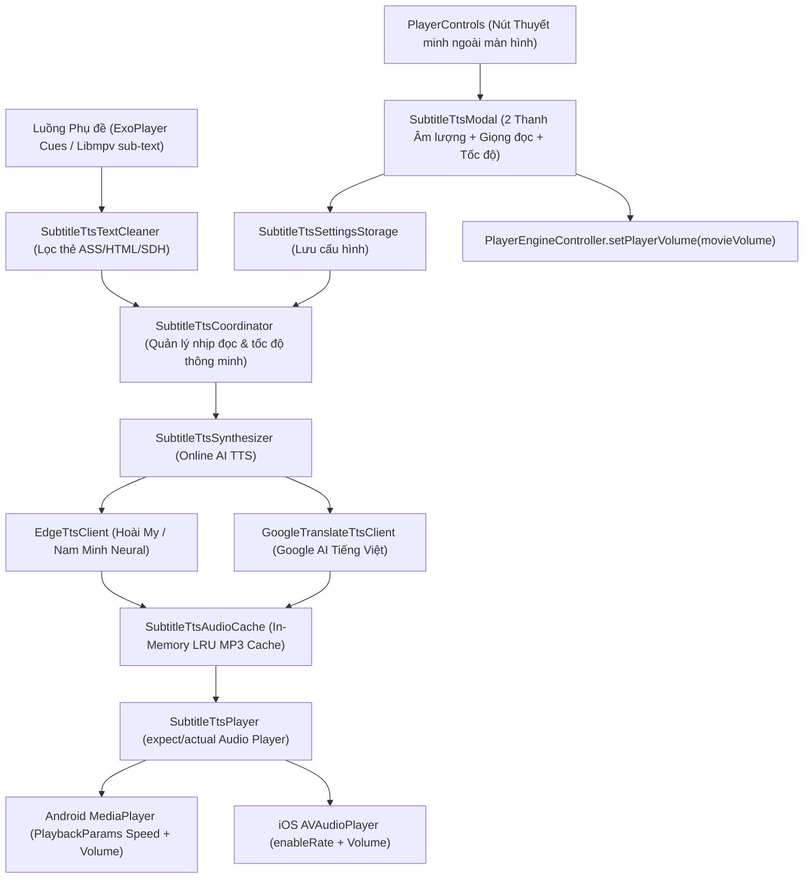

# Kế hoạch Chiến lược: Tích hợp Thuyết minh Phụ đề bằng AI (Subtitle TTS)

> **Mã kế hoạch**: `PLAN-subtitle-tts`  
> **Trạng thái**: Chờ duyệt (Pending Review)  
> **Người thực hiện**: Agent mon  
> **Ngày lập**: 19/11/2026  

---

## 🎯 1. Mục tiêu Cốt lõi (Core Goals)

1. **Bộ máy Online AI TTS Đa Giọng Đọc (Edge Neural TTS & Google AI TTS)**:
   - Tích hợp giọng đọc AI trực tuyến chất lượng cao cho Tiếng Việt:
     - **Hoài My (`vi-VN-HoaiMyNeural`)** - Giọng nữ Microsoft Edge AI truyền cảm, tự nhiên.
     - **Nam Minh (`vi-VN-NamMinhNeural`)** - Giọng nam Microsoft Edge AI trầm ấm.
     - **Google AI Tiếng Việt (`google-vi`)** - Phản hồi cực nhanh qua giao thức HTTP MP3, đồng thời đóng vai trò fallback tự động nếu kết nối WebSocket bị nghẽn.
   - Tích hợp bộ nhớ đệm **In-Memory LRU Audio Cache** để lưu trữ các câu phụ đề đã tổng hợp, giúp phát tức thì (độ trễ ~0ms) và tiết kiệm băng thông.

2. **Điều chỉnh Độc lập 2 Thanh Âm lượng (Dual Volume Controls)**:
   - **Thanh 1 - Âm lượng phim gốc (`movieVolume`: 0% – 100%)**: Giữ âm lượng video gốc cố định ở mức người dùng chọn khi bật TTS (mặc định `25%`), và tự động khôi phục về `100%` ngay khi tắt TTS.
   - **Thanh 2 - Âm lượng giọng đọc TTS (`ttsVolume`: 0% – 100%)**: Điều chỉnh độ lớn của giọng thuyết minh độc lập hoàn toàn với âm lượng phim (mặc định `100%`).

3. **Tốc độ Đọc Thông minh & Ngắt Câu Tức thì (Smart Dynamic Speed & Cue Interruption)**:
   - **Tự động tăng tốc theo độ dài câu**: Tự động tính toán hệ số nhân tốc độ đọc dựa trên số lượng ký tự của câu phụ đề hiện tại (từ `baseSpeed` lên tối đa `1.85x`) để kịp khớp nhịp hội thoại dài.
   - **Ngắt câu cũ khi câu mới xuất hiện**: Ngay khi câu phụ đề mới xuất hiện trên màn hình (hoặc người dùng tua/tạm dừng video), hệ thống lập tức ngắt câu đang đọc dở để đọc câu mới nhất, không bao giờ bị trễ nhịp so với hình ảnh.
   - **Làm sạch văn bản phụ đề**: Tự động loại bỏ mã định dạng ASS/SSA (`{\an8}`, `{\i1}`), thẻ HTML (`<i>`, `<font>`), ký hiệu âm nhạc (`♪`, `♫`) và ghi chú âm thanh nền (`[tiếng cười]`, `(thở dài)`).

4. **Nút Bật/Tắt & Điều khiển Nhanh ngoài Màn hình Player (`PlayerControls`)**:
   - Đặt nút biểu tượng **Loa Thuyết minh (`RecordVoiceOver`)** ngay trên thanh điều khiển ngoài của Player (cạnh nút Phụ đề và Âm thanh), đổi màu nổi bật (`accent`) khi TTS đang bật.
   - Bấm vào mở bảng **Bảng Điều khiển Nhanh Thuyết minh Phụ đề (`SubtitleTtsModal`)** gồm: Công tắc Bật/Tắt nhanh, Chọn giọng đọc AI, 2 thanh trượt âm lượng (Phim gốc & Giọng đọc), và Thanh chỉnh tốc độ đọc.

---

## ⚠️ 2. Phân tích Rủi ro & Kiến trúc Phụ thuộc (Dependency & Risk Analysis)

> [!IMPORTANT]
> **Đồng bộ trên cả 3 Engine Phát Video của Nuvio (Android ExoPlayer, Android Libmpv, iOS Libmpv)**:
> - Việc lấy văn bản phụ đề thời gian thực (`activeSubtitleText`) và điều chỉnh âm lượng phim gốc (`setPlayerVolume`) cần hoạt động thống nhất trên cả:
>   1. **Android ExoPlayer**: Lấy text từ `SubtitleCuePresenter` và chỉnh `exoPlayer.volume`.
>   2. **Android Libmpv**: Lấy text từ `mpv.getPropertyString("sub-text")` trong `NuvioLibmpvView` và chỉnh `mpv.setPropertyDouble("volume", ...)`.
>   3. **iOS Libmpv**: Lấy text từ `bridge.setSubtitleTextHandler` và chỉnh âm lượng qua `PlayerBridge`.

> [!WARNING]
> **Độ trễ Mạng khi Gọi Online AI TTS & Cơ chế Fallback**:
> - Phụ đề phim xuất hiện theo thời gian thực, nếu mạng chập chờn hoặc WebSocket Edge TTS khởi tạo chậm (> 1000ms) có thể làm trễ câu thoại đầu tiên.
> - **Giải pháp**:
>   1. Giữ kết nối hoặc timeout ngắn (1200ms) cho Edge TTS; nếu quá thời gian tự động chuyển sang luồng HTTP MP3 của Google Translate TTS (~150ms).
>   2. Áp dụng `PlaybackParams` (Android `MediaPlayer`) và `AVAudioPlayer.rate` (iOS) để tăng tốc độ phát âm thanh ngay tại máy khách mà không cần tải lại file âm thanh khi đổi tốc độ.

> [!NOTE]
> **Quản lý Vòng đời Âm thanh (Audio Lifecycle Leak Prevention)**:
> - Khi người dùng thoát khỏi `PlayerScreen`, chuyển tập phim mới, hoặc ứng dụng vào nền (Background), bộ phát `SubtitleTtsPlayer` và các coroutine tổng hợp giọng nói phải được hủy và giải phóng (`release()`) ngay lập tức trong `DisposableEffect`.

---

## 🗺️ 3. Chuỗi Phụ thuộc Kỹ thuật (Architecture & Dependency Chain)



---

## 📋 4. Kế hoạch Triển khai Chi tiết (Phase-by-Phase Breakdown)

### 🔹 Giai đoạn 1: Lưu trữ Cấu hình & Model TTS (`Models & Storage`)
- **Tệp tạo mới / chỉnh sửa**:
  - `composeApp/src/commonMain/kotlin/com/nuvio/app/features/player/tts/SubtitleTtsModels.kt`
  - `composeApp/src/commonMain/kotlin/com/nuvio/app/features/player/tts/SubtitleTtsStorage.kt`
  - `composeApp/src/androidMain/kotlin/com/nuvio/app/features/player/tts/SubtitleTtsStorage.android.kt`
  - `composeApp/src/iosMain/kotlin/com/nuvio/app/features/player/tts/SubtitleTtsStorage.ios.kt`
- **Chi tiết thực hiện**:
  1. Định nghĩa `enum class SubtitleTtsVoice`:
     - `EdgeHoaiMy` (`vi-VN-HoaiMyNeural` - Nữ)
     - `EdgeNamMinh` (`vi-VN-NamMinhNeural` - Nam)
     - `GoogleVi` (`vi` - Google AI Tiếng Việt)
  2. Định nghĩa `data class SubtitleTtsSettings`:
     - `enabled: Boolean = false`
     - `voice: SubtitleTtsVoice = SubtitleTtsVoice.EdgeHoaiMy`
     - `movieVolume: Float = 0.25f`
     - `ttsVolume: Float = 1.0f`
     - `baseSpeed: Float = 1.15f`
     - `autoSpeedEnabled: Boolean = true`
  3. Lưu trữ bền vững qua `SharedPreferences` (Android) và `NSUserDefaults` (iOS).

### 🔹 Giai đoạn 2: Bộ máy Online AI TTS & Bộ phát Âm thanh Đa nền tảng (`Synthesizer & Audio Player`)
- **Tệp tạo mới**:
  - `composeApp/src/commonMain/kotlin/com/nuvio/app/features/player/tts/SubtitleTtsTextCleaner.kt`
  - `composeApp/src/commonMain/kotlin/com/nuvio/app/features/player/tts/SubtitleTtsSynthesizer.kt`
  - `composeApp/src/commonMain/kotlin/com/nuvio/app/features/player/tts/SubtitleTtsPlayer.kt`
  - `composeApp/src/androidMain/kotlin/com/nuvio/app/features/player/tts/SubtitleTtsPlayer.android.kt`
  - `composeApp/src/iosMain/kotlin/com/nuvio/app/features/player/tts/SubtitleTtsPlayer.ios.kt`
  - `composeApp/src/commonMain/kotlin/com/nuvio/app/features/player/tts/SubtitleTtsCoordinator.kt`
- **Chi tiết thực hiện**:
  1. Xây dựng `SubtitleTtsTextCleaner`: Lọc sạch thẻ định dạng, ký tự đặc biệt và chuẩn hóa câu. Tính toán tốc độ đọc thông minh `calculateEffectiveSpeed(text, baseSpeed, autoSpeedEnabled)`.
  2. Xây dựng `SubtitleTtsSynthesizer`:
     - Hỗ trợ tổng hợp giọng nói qua Edge Neural TTS (SSML WebSocket) và Google Translate TTS (HTTP MP3), kèm bộ nhớ đệm `LruCache` trong RAM.
  3. Xây dựng `SubtitleTtsPlayer` (`expect/actual`):
     - Phát trực tiếp mảng byte MP3 (`ByteArray`) với `volume` (`ttsVolume`) và `speed` (`effectiveSpeed`).
     - Hỗ trợ hàm `stop()` ngắt tiếng ngay lập tức khi câu phụ đề mới xuất hiện.

### 🔹 Giai đoạn 3: Kết nối Âm lượng Phim gốc & Luồng Phụ đề trong `PlayerEngine`
- **Tệp chỉnh sửa**:
  - `composeApp/src/commonMain/kotlin/com/nuvio/app/features/player/PlayerEngine.kt`
  - `composeApp/src/androidMain/kotlin/com/nuvio/app/features/player/PlayerEngine.android.kt`
  - `composeApp/src/iosMain/kotlin/com/nuvio/app/features/player/PlayerEngine.ios.kt`
  - `composeApp/src/androidMain/kotlin/com/nuvio/app/features/player/SubtitleCuePresenter.kt`
- **Chi tiết thực hiện**:
  1. Bổ sung `fun setPlayerVolume(volume: Float)` vào `PlayerEngineController`.
  2. Triển khai `setPlayerVolume` cho ExoPlayer (`exoPlayer.volume = volume`), Android Libmpv (`mpv.setPropertyDouble("volume", ...)`), và iOS Player.
  3. Phát sự kiện văn bản phụ đề hiện tại (`onActiveSubtitleTextChanged: (String) -> Unit` hoặc StateFlow) mỗi khi cue phụ đề thay đổi trên cả ExoPlayer và Libmpv (kể cả khi dùng Styled Overlay hay Native Subtitle View).

### 🔹 Giai đoạn 4: Giao diện Nút Điều khiển Ngoài & Bảng Cài đặt Nhanh (`UI Controls & Modal`)
- **Tệp tạo mới / chỉnh sửa**:
  - `composeApp/src/commonMain/kotlin/com/nuvio/app/features/player/tts/SubtitleTtsModal.kt`
  - `composeApp/src/commonMain/kotlin/com/nuvio/app/features/player/PlayerControlActions.kt`
  - `composeApp/src/commonMain/kotlin/com/nuvio/app/features/player/PlayerControls.kt`
  - `composeApp/src/commonMain/kotlin/com/nuvio/app/features/player/FoldControls.kt`
  - `composeApp/src/commonMain/kotlin/com/nuvio/app/features/player/PlayerScreenRuntimeUi.kt`
  - `composeApp/src/commonMain/composeResources/values-vi/strings.xml` & `values/strings.xml`
- **Chi tiết thực hiện**:
  1. Thêm nút icon **Thuyết minh (`Icons.Rounded.RecordVoiceOver`)** lên thanh điều khiển ngoài của Player (hỗ trợ trạng thái đổi màu `accent` khi đang bật TTS).
  2. Thiết kế `SubtitleTtsModal` đồng bộ phong cách với `AudioTrackModal` / `SubtitleModal`:
     - Nút gạt Bật/Tắt Đọc phụ đề (TTS).
     - Danh sách chọn giọng đọc Online AI (Hoài My, Nam Minh, Google AI).
     - Thanh trượt **Âm lượng phim gốc (0% - 100%)**.
     - Thanh trượt **Âm lượng giọng đọc TTS (0% - 100%)**.
     - Thanh trượt **Tốc độ đọc cơ bản (`0.8x` - `1.5x`)** + tùy chọn **Tự động tăng tốc khi câu dài**.

---

## 🧪 5. Kế hoạch Kiểm thử & Nghiệm thu (Verification Plan)

### A. Kiểm thử Tự động (Automated Verification)
- [ ] Biên dịch kiểm tra KMP Metadata:
  ```powershell
  ./gradlew :composeApp:compileCommonMainKotlinMetadata
  ```
- [ ] Viết và chạy Unit Test `SubtitleTtsTextCleanerTest`:
  - Kiểm tra lọc thẻ ASS/SSA (`{\an8}`, `{\c&HFFFFFF&}`), thẻ HTML (`<i>...</i>`), thẻ SDH (`[tiếng nổ]`).
  - Kiểm tra thuật toán tự động tăng tốc độ đọc theo độ dài câu (`calculateEffectiveSpeed`).
  ```powershell
  ./gradlew :composeApp:testAndroidHostTest --tests "com.nuvio.app.features.player.tts.SubtitleTtsTextCleanerTest"
  ```

### B. Kiểm thử Thủ công trên Ứng dụng (Manual Verification)
1. Mở một bộ phim bất kỳ có phụ đề Tiếng Việt.
2. Bấm vào nút **Icon Loa Thuyết minh** ngay trên thanh điều khiển Player ngoài màn hình.
3. Bật công tắc **Đọc phụ đề (TTS)** và chọn giọng **Hoài My** hoặc **Nam Minh**:
   - Kiểm tra giọng đọc phát lên ngay khi dòng phụ đề xuất hiện.
   - Kéo thử 2 thanh **Âm lượng phim gốc** (vd: 25%) và **Âm lượng giọng đọc** (vd: 100%) ➔ Kiểm tra tiếng phim nhỏ xuống cố định ở 25% và tiếng thuyết minh rõ ràng ở 100%.
   - Khi sang câu phụ đề mới nhanh ➔ Câu cũ tự động ngắt, đọc ngay câu mới với tốc độ tự động điều chỉnh khớp nhịp phim.
   - Bấm Pause hoặc tắt TTS ➔ Giọng đọc dừng ngay lập tức, âm lượng phim tự động trở về 100%.
