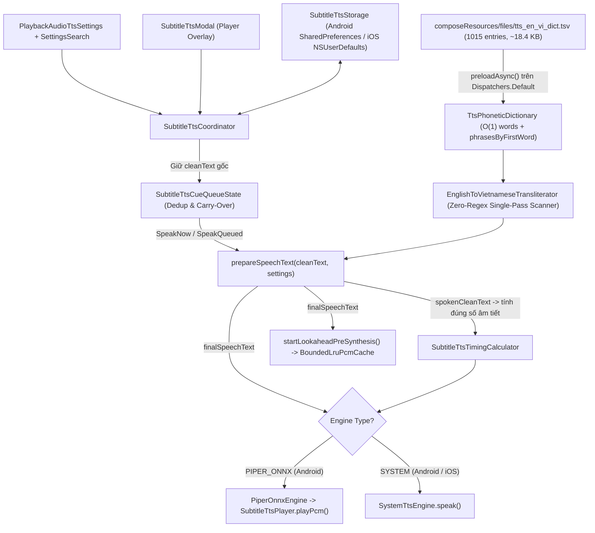

# Kế hoạch Chiến lược: Tích hợp Phiên âm Tên riêng & Từ tiếng Anh cho TTS Tiếng Việt (Port từ Nuvio TV)

> **Mã kế hoạch**: `PLAN-tts-english-proper-name-transliteration`  
> **Trạng thái**: Hoàn tất triển khai & kiểm thử tự động (Implemented & Verified)  
> **Người lập**: Agent mon  
> **Ngày lập**: 23/11/2026  
> **Nguồn tham chiếu**: `F:\MyGithub\NuvioTV-Fast` (`tts_en_vi_dict.tsv`, `TtsPhoneticDictionary.kt`, `EnglishToVietnameseTransliterator.kt`, `SubtitleTtsCoordinator.kt`, tối ưu hiệu năng commit `b88070ef8`)  
> **Ghi chú cho Agent thực thi**: Dùng skill `subagent-driven-development` (khuyến nghị) hoặc `executing-plans` để triển khai lần lượt từng task. Đánh dấu hộp kiểm (`- [x]`) sau mỗi bước đã kiểm chứng.

---

## 🎯 1. Mục tiêu Cốt lõi & Kiến trúc Tổng thể

### Mục tiêu
Tích hợp hoàn chỉnh tính năng **phiên âm sẵn tên nhân vật, địa danh, từ viết tắt và từ tiếng Anh phổ biến sang ngữ âm tiếng Việt** từ `NuvioTV-Fast` sang `NuvioMobile-Fast` (Kotlin Multiplatform: **Android + iOS**), hoạt động mượt mà với **độ trễ bằng 0 (Zero-Latency)** trên cả hai bộ máy TTS offline hiện có:
1. **Google Speech / Hệ thống** (`SystemTtsEngine` — Android `TextToSpeech` & iOS `AVSpeechSynthesizer`): giữ nguyên 1 giọng Tiếng Việt (`vi-VN`), không chuyển đổi giọng sang tiếng Anh giữa câu, không gây khựng tiếng.
2. **Piper AI (ONNX / `sherpa-onnx`)**: đặc biệt cải thiện mạnh chất lượng đọc vì các model Piper tiếng Việt (`ngochuyen5`, `lacphi`, `ngochuyen`) dùng `espeak-ng` (`voice=vi`) vốn đọc tên tiếng Anh gốc rất méo hoặc đánh vần rời từng chữ cái.

### Kiến trúc & Tech Stack
- **Đa nền tảng (KMP)**: Toàn bộ bộ phân tích từ điển (`TtsPhoneticDictionary`) và bộ phiên âm (`EnglishToVietnameseTransliterator`) viết 100% bằng **Kotlin thuần trong `commonMain`** — không phụ thuộc `java.util.Locale`, `Character`, `InputStream`, hay Hilt DI — chạy đồng nhất trên Android (JVM) và iOS (Kotlin/Native).
- **Tài nguyên dùng chung**: Đóng gói 1 file từ điển duy nhất `composeApp/src/commonMain/composeResources/files/tts_en_vi_dict.tsv` (**1.015 mục**, ~18,4 KB) qua **Compose Multiplatform Resources** (`Res.readBytes("files/tts_en_vi_dict.tsv")`), tự động đi kèm cả APK Android lẫn iOS App Bundle mà không cần sửa `project.pbxproj`.
- **Tích hợp Đồng bộ Nhịp & Cache**: Áp dụng `prepareSpeechText(...)` thống nhất cho cả phát trực tiếp (`startSpeakingCue`), hàng đợi chờ hết câu (`handlePlaybackCompleted` / `startCarryOverTimer`), nghe thử giọng (`previewVoice`), và **tiền tổng hợp câu kế tiếp (`startLookaheadPreSynthesis`)** của Piper ONNX; tính tốc độ `SubtitleTtsTimingCalculator` dựa trên `spokenCleanText` (sau phiên âm) để đo đúng số âm tiết tiếng Việt thực tế.

### Ràng buộc Toàn cục (Global Constraints)
- **Zero Main-Thread I/O**: Tuyệt đối không đọc file tài nguyên trên Main Thread; `TtsPhoneticDictionary.preloadAsync(scope)` nạp trên `Dispatchers.Default`, `getDictionary()` luôn non-blocking trả `ParsedDictionary.EMPTY` nếu chưa nạp xong.
- **Zero Per-Cue Regex Compilation**: Kế thừa bài học từ `ERRORS.md` của `NuvioTV-Fast` (`b88070ef8`) — không biên dịch `Regex` trong hot-path mỗi câu phụ đề; dùng **single-pass scanner không Regex** kết hợp chỉ mục `phrasesByFirstWord: Map<String, List<PhraseEntry>>` tra cứu $O(1)$.
- **Tương thích ngược KMP Storage**: Thêm trường `transliterateEnglishNames: Boolean = true` (mặc định Bật, giống `NuvioTV-Fast`) vào `SubtitleTtsSettings`, lưu theo `ProfileScopedKey` trên cả Android (`SharedPreferences`) và iOS (`NSUserDefaults`).
- **Tách biệt Dedup & Phiên âm**: `SubtitleTtsCueQueueState` giữ nguyên `cleanText` gốc (chưa phiên âm) cho logic chống lặp cue để việc bật/tắt tùy chọn giữa phim không làm sai lịch sử đã đọc.
- **Giữ sạch Upstream Strings**: Dùng chuỗi Tiếng Việt nhất quán trực tiếp trong các màn hình TTS riêng của `NuvioMobile-Fast` (`PlaybackAudioTtsSettings.kt`, `SubtitleTtsModal.kt`, `SettingsSearch.kt`) để tránh xung đột khi merge `upstream`.

---

## ⚠️ 2. Phân tích Rủi ro, Cải tiến so với Nuvio TV & Review Focus

> [!IMPORTANT]
> **Sửa 3 lỗi tinh tế phát hiện khi đối chiếu mã nguồn `NuvioTV-Fast`**:
> 1. **Từ ghép chứa dấu gạch nối / dấu chấm bị bỏ sót**: Trong `NuvioTV-Fast`, `TtsPhoneticDictionary` chỉ tách bằng khoảng trắng (`\s+`) nên 6 mục trong `tts_en_vi_dict.tsv` (`spider-man`, `obi-wan`, `middle-earth`, `feyd-rautha`, `wi-fi`, `k.o`) bị xếp vào `words` thay vì `phrasesByFirstWord`, nhưng tokenizer lại tách theo dấu `-`/`.` khiến chúng **không bao giờ khớp**. Khi port sang `NuvioMobile-Fast`, mọi khóa có nhiều từ **hoặc** chứa ký tự phân cách ngoài chữ/số/`'` đều được xếp vào `phrases` & lập chỉ mục `phrasesByFirstWord`.
> 2. **Dấu nháy cong Unicode (`’` / `\u2019`) trong phụ đề SRT/ASS**: Trong `NuvioTV-Fast`, `TOKEN_REGEX` chỉ khớp `'` ASCII nên `John’s`, `King’s Landing`, `You’re welcome` bị tách rời trước khi kiểm tra sở hữu cách hoặc cụm từ. Scanner mới bao gồm cả `’` và chuẩn hóa `’` ➔ `'` khi tra bảng.
> 3. **URL/Email nằm giữa câu**: Trong `NuvioTV-Fast`, chỉ bỏ qua khi cả câu bắt đầu bằng `http://`/`https://`. Scanner mới bảo vệ từng cụm URL (`http://`, `https://`, `www.`) và email (`user@domain.com`) ngay cả khi xuất hiện giữa câu phụ đề.

> [!WARNING]
> **Rủi ro Cache Miss ở Piper Lookahead Pre-Synthesis**:
> - `NuvioMobile-Fast` có cơ chế `startLookaheadPreSynthesis(...)` tiền tổng hợp 2 câu phụ đề sắp tới vào `BoundedLruPcmCache` theo `PcmCacheKey(modelId, speechText, quantizedSpeedBucket)`.
> - Nếu chỉ phiên âm ở `startSpeakingCue(...)` mà quên phiên âm ở `startLookaheadPreSynthesis(...)`, toàn bộ câu có tên riêng tiếng Anh sẽ bị **100% cache miss** và lãng phí CPU ONNX.
> - Bắt buộc gọi chung `prepareSpeechText(...)` ở cả hai nơi, đồng thời **xóa `pcmCache` và hủy `lookaheadJob`** ngay khi người dùng bật/tắt `transliterateEnglishNames` trong `updateSettings(...)`.

> [!NOTE]
> **Tự động tắt phiên âm khi người dùng dùng giọng ngoại ngữ trên `SystemTtsEngine`**:
> - `NuvioMobile-Fast` không có trường `preferredLanguageCode` như `NuvioTV-Fast`. Thay vào đó, ta xác định mục tiêu tiếng Việt qua `isVietnameseTtsTarget(...)`:
>   - `PIPER_ONNX` ➔ luôn là tiếng Việt (`true`).
>   - `SYSTEM` với `systemVoiceName == null` hoặc `"default_vi"` ➔ mặc định chọn `vi-VN` (`true`).
>   - `SYSTEM` với `systemVoiceName` cụ thể ➔ tra locale trong `SystemTtsEngine.availableVoices.value`; chỉ tắt phiên âm khi xác định rõ giọng thuộc ngôn ngữ khác `vi` (ví dụ `en-US`, `ja-JP`).

### Review Focus (5 tình huống biên dễ gây lỗi thực tế cần khóa bằng Unit Test)
1. **Từ ghép có gạch nối / dấu chấm & xung đột độ dài tiền tố**: `"Obi-Wan Kenobi và Obi-Wan gặp Spider-Man qua Wi-Fi ở Middle-Earth"` phải khớp `"Obi-Wan Kenobi"` trước `"Obi-Wan"`, khớp `"Spider-Man"`, `"Wi-Fi"`, `"Middle-Earth"` thay vì tách lẻ.
2. **Dấu nháy cong `’` (`\u2019`) trong sở hữu cách & cụm từ**: `"King’s Landing và John’s xe hơi, you’re welcome"` phải khớp chính xác cả cụm lẫn sở hữu cách như dấu `'` ASCII.
3. **Từ tiếng Việt không dấu viết hoa đầu câu & chữ có dấu**: `"Anh, Em, Con, Minh, Nam, Lan, Khi, Nhưng, Trong, Phim Việt Nam rất hay"` tuyệt đối không bị phiên âm sai sang ngữ âm ngoại lai.
4. **Hiệu năng & An toàn luồng trên câu dài có nhiều tên riêng**: 500 lần `transliterate(...)` liên tiếp phải chạy `< 500ms`, không phát sinh `Regex` compile mới và `getDictionary()` không bao giờ ném lỗi khi chưa preload xong.
5. **Đồng bộ `PcmCacheKey` giữa Lookahead và Speak + Tắt phiên âm với giọng `en-US`**: Key PCM sinh ra ở lookahead và ở lúc phát phải trùng khớp 100%; khi chọn giọng hệ thống `en-US` thì `prepareSpeechText(...)` phải giữ nguyên nguyên bản tiếng Anh.

---

## 🗺️ 3. Chuỗi Phụ thuộc & Luồng Xử lý (Architecture & Dependency Chain)



---

## 📋 4. Kế hoạch Triển khai Chi tiết (Task-by-Task Breakdown)

### 🔹 Task 1 (`TASK-TTSTRANS-01`): Đóng gói Từ điển `tts_en_vi_dict.tsv` & Xây dựng `TtsPhoneticDictionary` Đa nền tảng
**Phụ trách**: `backend-specialist` (KMP Core / Resources)

**Files:**
- Create: `composeApp/src/commonMain/composeResources/files/tts_en_vi_dict.tsv` (sao chép nguyên vẹn UTF-8 từ `F:\MyGithub\NuvioTV-Fast\app\src\main\assets\tts_en_vi_dict.tsv`)
- Create: `composeApp/src/commonMain/kotlin/com/nuvio/app/features/player/tts/TtsPhoneticDictionary.kt`
- Test: `composeApp/src/androidHostTest/kotlin/com/nuvio/app/features/player/tts/TtsPhoneticDictionaryAssetTest.kt`

**Interfaces:**
- Consumes: `nuvio.composeapp.generated.resources.Res` (`Res.readBytes`), `kotlinx.atomicfu.atomic`, `kotlinx.coroutines.CoroutineScope`, `kotlinx.coroutines.Dispatchers`
- Produces:
  - `data class PhraseEntry(val tokens: List<String>, val rawKey: String, val phonetic: String)`
  - `data class ParsedDictionary(val phrases: List<PhraseEntry>, val words: Map<String, String>, val phrasesByFirstWord: Map<String, List<PhraseEntry>> = emptyMap())` (với `ParsedDictionary.EMPTY`)
  - `object TtsPhoneticDictionary`:
    - `const val DICT_RESOURCE_PATH = "files/tts_en_vi_dict.tsv"`
    - `fun parseFromText(rawTsv: String): ParsedDictionary`
    - `fun preloadAsync(scope: CoroutineScope)`
    - `fun getDictionary(): ParsedDictionary`

**Các bước thực hiện:**
- [ ] **Step 1**: Sao chép `F:\MyGithub\NuvioTV-Fast\app\src\main\assets\tts_en_vi_dict.tsv` sang `composeApp/src/commonMain/composeResources/files/tts_en_vi_dict.tsv` (bảo toàn UTF-8 không BOM).
- [ ] **Step 2**: Viết test ban đầu trong `TtsPhoneticDictionaryAssetTest.kt` xác minh:
  - File `src/commonMain/composeResources/files/tts_en_vi_dict.tsv` tồn tại, đọc được `>= 1000` entries, `0` dòng lỗi format, không trùng khóa.
  - `TtsPhoneticDictionary.parseFromText(...)` xếp cả cụm có dấu cách (`tony stark`, `fast & furious`, `obi-wan kenobi`) **lẫn** từ ghép dấu gạch nối/dấu chấm (`spider-man`, `obi-wan`, `middle-earth`, `feyd-rautha`, `wi-fi`, `k.o`) vào `phrasesByFirstWord`, với `"obi-wan kenobi"` đứng trước `"obi-wan"` trong bucket `"obi"`.
- [ ] **Step 3**: Triển khai `TtsPhoneticDictionary.kt` trong `commonMain`:
  - Chuẩn hóa khóa bằng `.trim().lowercase().replace('\u2019', '\'')`.
  - Trích `firstWord` và phân tách `tokens` bằng vòng lặp ký tự thuần Kotlin (zero regex).
  - Khóa thuộc `phrases` nếu có `> 1` token hoặc chứa ký tự không phải `isLetterOrDigit() || it == '\''`; sắp xếp giảm dần theo `tokens.size` rồi `rawKey.length`.
  - Dùng `kotlinx.atomicfu.atomic` cho `cachedDictionary` và `preloadStarted`; `preloadAsync(scope)` chạy trên `Dispatchers.Default` đọc `Res.readBytes(DICT_RESOURCE_PATH).decodeToString()`, bọc `runCatching` an toàn.
- [ ] **Step 4**: Chạy `:composeApp:testAndroidHostTest --tests "com.nuvio.app.features.player.tts.TtsPhoneticDictionaryAssetTest" -Pnuvio.android.distribution=full` xác nhận PASS.

---

### 🔹 Task 2 (`TASK-TTSTRANS-02`): Xây dựng Bộ Phiên âm `EnglishToVietnameseTransliterator` Thuần KMP
**Phụ trách**: `backend-specialist` (KMP Core / NLP Logic)

**Files:**
- Create: `composeApp/src/commonMain/kotlin/com/nuvio/app/features/player/tts/EnglishToVietnameseTransliterator.kt`
- Test: `composeApp/src/commonTest/kotlin/com/nuvio/app/features/player/tts/EnglishToVietnameseTransliteratorTest.kt`

**Interfaces:**
- Consumes: `TtsPhoneticDictionary.ParsedDictionary`, `TtsPhoneticDictionary.PhraseEntry`, `TtsPhoneticDictionary.getDictionary()`
- Produces:
  - `class EnglishToVietnameseTransliterator(private val dictionaryProvider: () -> TtsPhoneticDictionary.ParsedDictionary)`
  - `constructor(preset: TtsPhoneticDictionary.ParsedDictionary)` (dùng cho test)
  - `EnglishToVietnameseTransliterator.Default` (dùng `TtsPhoneticDictionary.getDictionary()`)
  - `EnglishToVietnameseTransliterator.VIETNAMESE_STOP_WORDS: Set<String>`
  - `fun transliterate(text: String): String`

**Các bước thực hiện:**
- [ ] **Step 1**: Viết toàn bộ unit test trong `commonTest/.../EnglishToVietnameseTransliteratorTest.kt` phủ các nhóm:
  - Cụm tên nhân vật & địa danh nhiều từ (`Tony Stark`, `Doctor Strange`, `John Wick`, `New York`, `Los Angeles`).
  - Cụm/từ có dấu gạch nối, `&`, `.` (`Spider-Man`, `Obi-Wan Kenobi`, `Obi-Wan`, `Fast & Furious`, `Wi-Fi`, `Middle-Earth`, `K.O`).
  - Tên đơn từ điển (`Thanos`, `Sherlock`, `Michael`), từ tiếng Anh phổ biến (`Hello`, `Thank you`, `OK`, `boss`).
  - Từ viết tắt HOA 2–5 ký tự (`FBI`, `CIA`, `MIT`, `KGB`).
  - Sở hữu cách cả dấu `'` thẳng lẫn `’` cong (`John's`, `John’s`, `King’s Landing`, `You’re welcome`).
  - Rule-based fallback cho tên lạ (`Krypton`, `Voldemort`, `Hawkins`) không có trong dict rút gọn của test.
  - Bảo vệ tiếng Việt: từ có dấu và các stop words viết hoa đầu câu (`Anh`, `Em`, `Con`, `Minh`, `Nam`, `Lan`, `Khi`, `Nhưng`, `Trong`, `Việt Nam`).
  - Bảo vệ dấu câu, chuỗi rỗng/khoảng trắng, và bảo vệ URL/email nằm giữa câu (`"Xem tại https://nuvio.tv/test hoặc gửi admin@nuvio.tv nhé"`).
- [ ] **Step 2**: Triển khai `EnglishToVietnameseTransliterator.kt` hoàn toàn trong `commonMain`:
  - Loại bỏ mọi phụ thuộc JVM (`Locale`, `Character`, `javax.inject`), dùng Kotlin stdlib `lowercase()`, `isLetterOrDigit()`, `isUpperCase()`, `isLowerCase()`, `titlecase()`.
  - Dùng **single-pass character scanner** (không biên dịch `Regex`):
    - Phát hiện và chép nguyên cụm URL (`http://`, `https://`, `www.`) hoặc email (chứa `@` kẹp giữa ký tự hợp lệ).
    - Với mỗi word token (`isLetterOrDigit() || ch == '\'' || ch == '\u2019'`), kiểm tra word boundary trước token, tra $O(1)$ vào `phrasesByFirstWord[lowerToken]` trên `normalizedLower` (đã chuyển `\u2019` ➔ `'`) và kiểm tra word boundary sau `endIndex`.
    - Nếu không khớp cụm, xử lý `transliterateSingleToken`:
      1. Có ký tự trong `VIETNAMESE_SPECIFIC_CHARS` ➔ giữ nguyên.
      2. Tách hậu tố sở hữu `'s` / `’s` (khi `token.length > 2`) thành `baseToken` + `" của"`.
      3. Thuộc `VIETNAMESE_STOP_WORDS` (đã khử phần tử trùng thừa từ bản gốc TV) ➔ giữ nguyên.
      4. Khớp `words[lowerBase]` ➔ trả âm Việt.
      5. Viết tắt 2..5 chữ cái `'A'..'Z'` ➔ ghép theo `ACRONYM_SPELLOUT`.
      6. `isLikelyEnglishProperName(baseToken)` ➔ `applyRuleBasedPhonetics(baseToken)`.
- [ ] **Step 3**: Bổ sung benchmark hiệu năng 500 lần `transliterate` (`< 500ms`) cùng các case kiểm chứng file từ điển thật trong `TtsPhoneticDictionaryAssetTest.kt`.
- [ ] **Step 4**: Chạy test xác nhận PASS 100%.

---

### 🔹 Task 3 (`TASK-TTSTRANS-03`): Mở rộng `SubtitleTtsSettings` & Lưu trữ Đa nền tảng (Android / iOS)
**Phụ trách**: `backend-specialist` (Storage & Models)

**Files:**
- Modify: `composeApp/src/commonMain/kotlin/com/nuvio/app/features/player/tts/SubtitleTtsModels.kt`
- Modify: `composeApp/src/androidMain/kotlin/com/nuvio/app/features/player/tts/SubtitleTtsStorage.android.kt`
- Modify: `composeApp/src/iosMain/kotlin/com/nuvio/app/features/player/tts/SubtitleTtsStorage.ios.kt`
- Test: `composeApp/src/androidHostTest/kotlin/com/nuvio/app/features/player/tts/SubtitleTtsStorageTest.kt`
- Test: `composeApp/src/commonTest/kotlin/com/nuvio/app/features/player/tts/EnglishToVietnameseTransliteratorTest.kt` (bổ sung test `isVietnameseTtsTarget`)

**Interfaces:**
- Consumes: `SubtitleTtsSettings`, `SystemVoiceInfo`, `SubtitleTtsEngineType`, `ProfileScopedKey`
- Produces:
  - `SubtitleTtsSettings.transliterateEnglishNames: Boolean = true`
  - `fun isVietnameseTtsTarget(settings: SubtitleTtsSettings, availableVoices: List<SystemVoiceInfo>, overrideVoiceName: String? = null, usePiper: Boolean = settings.engineType == SubtitleTtsEngineType.PIPER_ONNX): Boolean`
  - Khóa lưu trữ `tts_transliterate_english_names` (Profile-scoped) trên cả Android & iOS.

**Các bước thực hiện:**
- [ ] **Step 1**: Cập nhật `SubtitleTtsStorageTest.kt` kiểm tra giá trị mặc định `defaults.transliterateEnglishNames == true` và lưu/đọc lại chính xác cả `false` lẫn `true`.
- [ ] **Step 2**: Cập nhật `SubtitleTtsModels.kt`:
  - Thêm `val transliterateEnglishNames: Boolean = true` vào `SubtitleTtsSettings`.
  - Thêm hàm `isVietnameseTtsTarget(...)` xử lý chuẩn cả `PIPER_ONNX`, giọng `SYSTEM` mặc định (`null` / `"default_vi"`), giọng `vi-VN`, giọng ngoại ngữ (`en-US`, `ja-JP`...), và fallback khi `availableVoices` rỗng.
- [ ] **Step 3**: Cập nhật `SubtitleTtsStorage.android.kt` và `SubtitleTtsStorage.ios.kt` đọc/ghi `tts_transliterate_english_names` với `ProfileScopedKey.of(...)` và mặc định `default.transliterateEnglishNames` (`true`).
- [ ] **Step 4**: Chạy `SubtitleTtsStorageTest` xác nhận PASS.

---

### 🔹 Task 4 (`TASK-TTSTRANS-04`): Tích hợp Phiên âm vào `SubtitleTtsCoordinator` (Speak, Lookahead Cache, Queue & Preview)
**Phụ trách**: `backend-specialist` (TTS Coordinator & Sync)

**Files:**
- Modify: `composeApp/src/commonMain/kotlin/com/nuvio/app/features/player/tts/SubtitleTtsCoordinator.kt`
- Test: `composeApp/src/androidHostTest/kotlin/com/nuvio/app/features/player/tts/SubtitleTtsCoordinatorTimingTest.kt`

**Interfaces:**
- Consumes: `TtsPhoneticDictionary.preloadAsync`, `EnglishToVietnameseTransliterator.Default`, `isVietnameseTtsTarget`, `SubtitleTtsSettings.transliterateEnglishNames`, `SubtitleTtsTextCleaner.ensureSentenceEndingPunctuation`
- Produces:
  - `internal fun prepareTtsSpeechText(cleanText: String, settings: SubtitleTtsSettings, availableVoices: List<SystemVoiceInfo> = SystemTtsEngine.availableVoices.value, overrideVoiceName: String? = null, usePiper: Boolean = settings.engineType == SubtitleTtsEngineType.PIPER_ONNX, transliterator: EnglishToVietnameseTransliterator = EnglishToVietnameseTransliterator.Default): Pair<String, String>`

**Các bước thực hiện:**
- [ ] **Step 1**: Viết test trong `SubtitleTtsCoordinatorTimingTest.kt` xác minh:
  - `prepareTtsSpeechText` phiên âm khi `transliterateEnglishNames = true` + đích tiếng Việt (cả `SYSTEM` mặc định và `PIPER_ONNX`).
  - `prepareTtsSpeechText` giữ nguyên văn bản khi `transliterateEnglishNames = false` HOẶC khi chọn giọng hệ thống `en-US`.
  - Tốc độ căn nhịp `calculateTimingAwareSpeed` trên `spokenCleanText` phản ánh đúng số âm tiết tăng thêm sau phiên âm (ví dụ `"Christopher"` ➔ `"Crít xtô phơ"`).
  - `PcmCacheKey` sinh ra cho Lookahead và cho Speak trùng khớp nhau khi bật phiên âm.
- [ ] **Step 2**: Cập nhật `SubtitleTtsCoordinator.kt`:
  - Trong `ensureLoaded()`: gọi `TtsPhoneticDictionary.preloadAsync(scope)` để làm nóng từ điển ngay trên nền `Dispatchers.Default`.
  - Trong `updateSettings(...)`: nếu `previous.transliterateEnglishNames != updated.transliterateEnglishNames`, gọi `cancelLookaheadJob()` và `pcmCache.clear()`.
  - Trong `startSpeakingCue(...)`: tính `val (spokenCleanText, finalSpeechText) = prepareTtsSpeechText(cleanText = cleanText, settings = settings)` rồi dùng `spokenCleanText` cho `calculateTimingAwareSpeed` & `estimateNaturalDurationMs`, và dùng `finalSpeechText` cho `SystemTtsEngine.speak` / `speakWithPiperOrFallback`. (Loại bỏ tham số `speechText` thừa truyền từ ngoài vào `startSpeakingCue` để tránh sai lệch).
  - Trong `startLookaheadPreSynthesis(...)`: gọi `val (uSpokenCleanText, uSpeechText) = prepareTtsSpeechText(cleanText = uCleanText, settings = settingsSnapshot, usePiper = true)` và dùng `uSpokenCleanText` để tính `uSpeed`, dùng `uSpeechText` tạo `PcmCacheKey` và gọi `PiperOnnxEngine.generatePcm(uSpeechText, uSpeed)`.
  - Trong `previewVoice(...)`: gọi `val (spokenCleanText, speechText) = prepareTtsSpeechText(cleanText = cleanText, settings = current, overrideVoiceName = targetVoiceName, usePiper = usePiper)`.
  - Giữ nguyên `cleanText` gốc bên trong `SubtitleTtsCueQueueState`.
- [ ] **Step 3**: Chạy `SubtitleTtsCoordinatorTimingTest` xác nhận PASS.

---

### 🔹 Task 5 (`TASK-TTSTRANS-05`): Thêm Công tắc UI trong Cài đặt Âm thanh, Tìm kiếm Cài đặt & Modal TTS trong Player
**Phụ trách**: `frontend-specialist` (Compose Multiplatform UI)

**Files:**
- Modify: `composeApp/src/commonMain/kotlin/com/nuvio/app/features/settings/PlaybackAudioTtsSettings.kt` (`GeneralTtsAudioRows`, khoảng dòng 877–891)
- Modify: `composeApp/src/commonMain/kotlin/com/nuvio/app/features/player/tts/SubtitleTtsModal.kt` (khoảng dòng 293–310)
- Modify: `composeApp/src/commonMain/kotlin/com/nuvio/app/features/settings/SettingsSearch.kt` (khoảng dòng 644–650)

**Interfaces:**
- Consumes: `SubtitleTtsSettings.transliterateEnglishNames`, `SubtitleTtsCoordinator.updateSettings`
- Produces:
  - Công tắc `SettingsSwitchRow` trong **Cài đặt ➔ Phát lại ➔ Âm thanh** (`PlaybackAudioTtsSettings.kt`):
    - Tiêu đề: `"Phiên âm tên riêng & từ tiếng Anh"`
    - Mô tả: `"Đọc tự nhiên tên nhân vật, địa danh và thuật ngữ tiếng Anh theo ngữ âm tiếng Việt"`
  - Công tắc `TtsModalToggleRow` trong **Bảng TTS của trình phát** (`SubtitleTtsModal.kt`):
    - Tiêu đề: `"Phiên âm tên riêng & từ tiếng Anh"`
    - Mô tả: `"Đọc tên nhân vật, địa danh và từ tiếng Anh theo âm tiếng Việt"`
  - Mục tìm kiếm `"tts-transliterate-english-names"` trong `SettingsSearch.kt` trỏ đến `SettingsPage.PlaybackAudio`.

**Các bước thực hiện:**
- [ ] **Step 1**: Thêm `SettingsSwitchRow` vào `GeneralTtsAudioRows` trong `PlaybackAudioTtsSettings.kt` (ngay dưới `"Chờ đọc hết câu trước khi chuyển"` và trên `"Ẩn phụ đề khi TTS đọc"`).
- [ ] **Step 2**: Thêm `TtsModalToggleRow` tương ứng vào `SubtitleTtsModal.kt` ở cùng vị trí để đồng bộ 2 chiều ngay trong lúc xem phim.
- [ ] **Step 3**: Đăng ký từ khóa `"tts-transliterate-english-names"` vào `SettingsSearch.kt` giúp người dùng tìm nhanh theo từ khóa `"phiên âm"`, `"tên riêng"`, `"tiếng anh"`, `"TTS"`.

---

### 🔹 Task 6 (`TASK-TTSTRANS-06`): Kiểm thử Tổng thể, Biên dịch Android Full & Kiểm chứng Thực tế
**Phụ trách**: `test-engineer` / `quality-inspector`

**Files:**
- Verify only (không sửa code chức năng; nếu có lỗi thì vá và ghi log theo `.agent/rules/error-logging.md`).

**Các bước thực hiện:**
- [ ] **Step 1 (Automated Tests)**: Chạy toàn bộ test suite trên host:
  ```powershell
  .\gradlew.bat :composeApp:testAndroidHostTest -Pnuvio.android.distribution=full
  ```
  Kỳ vọng: 100% PASS (bao gồm toàn bộ test TTS mới & cũ, không lỗi hồi quy).
- [ ] **Step 2 (Android Compile & Package)**: Đóng gói kiểm chứng Compose Resources và biên dịch Android Full:
  ```powershell
  .\gradlew.bat :androidApp:assembleFullDebug -Pnuvio.android.distribution=full
  ```
  Kỳ vọng: `BUILD SUCCESSFUL`, file `composeResources/nuvio.composeapp.generated.resources/files/tts_en_vi_dict.tsv` có mặt bên trong APK output.
- [ ] **Step 3 (Kiểm tra ProGuard / Release Safety)**: Xác nhận rule `-keep class com.nuvio.app.features.player.tts.** { *; }` hiện có trong `composeApp/proguard-rules.pro` đã bảo vệ toàn bộ class mới trong `com.nuvio.app.features.player.tts`.
- [ ] **Step 4 (Manual Verification Checklist trên thiết bị thật)**:
  - **Cài đặt ➔ Phát lại ➔ Âm thanh**: thấy công tắc `"Phiên âm tên riêng & từ tiếng Anh"` bật sẵn, tìm được qua ô tìm kiếm Cài đặt, thoát/mở lại app vẫn giữ trạng thái.
  - **Trong Player (`SubtitleTtsModal`)**: bật/tắt công tắc đồng bộ ngay với Cài đặt.
  - **Google Speech (`vi-VN` offline)**: xem phim có tên nhân vật (`Tony Stark`, `Spider-Man`, `Doctor Strange`, `Thanos`, `New York`, `FBI`) ➔ đọc trôi chảy theo âm Việt, không đổi sang giọng Anh, không lag UI.
  - **Piper AI (ONNX)**: bật giọng Ngọc Huyền / Lạc Phi ➔ tên nhân vật & từ tiếng Anh đọc tự nhiên thay vì méo tiếng, Lookahead pre-synth vẫn mượt không khựng câu; bật/tắt công tắc đổi ngay ở câu kế tiếp.
  - **An toàn tiếng Việt**: phụ đề tiếng Việt có từ viết hoa đầu câu (`Anh`, `Em`, `Minh`, `Nam`, `Lan`, `Khi`, `Nhưng`) đọc chuẩn tiếng Việt 100%.

---

## ✅ 5. Tiêu chí Nghiệm thu (Definition of Done)
1. Tất cả 6 task (`TASK-TTSTRANS-01` .. `TASK-TTSTRANS-06`) hoàn thành đầy đủ và vượt qua kiểm thử tự động (`testAndroidHostTest` PASS 100%) + biên dịch `assembleFullDebug` thành công.
2. Không có mã JVM-only lọt vào `commonMain` (đảm bảo tương thích biên dịch `iosArm64` / `iosSimulatorArm64`).
3. Không biên dịch `Regex` per-cue và không đọc file trên Main Thread (500 lần `transliterate` `< 500ms`).
4. Cả **Google Speech / Hệ thống** và **Piper AI (ONNX)** đều áp dụng phiên âm nhất quán, đồng bộ `PcmCacheKey` với Lookahead Pre-Synthesis.
