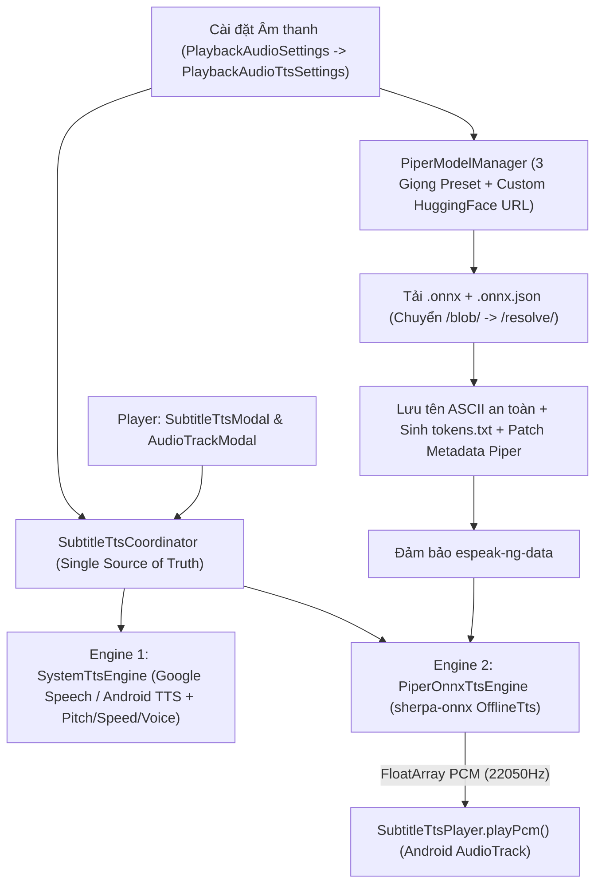

# Kế hoạch Chiến lược: TTS Offline Thuần Túy & Tích hợp vào Cài đặt Âm thanh

> **Mã kế hoạch**: `PLAN-tts-offline-and-huggingface`  
> **Trạng thái**: Chờ duyệt (Pending Review)  
> **Người thực hiện**: Agent mon  
> **Ngày lập**: 20/11/2026  

---

## 🎯 1. Mục tiêu Cốt lõi (Core Goals)

1. **Loại bỏ hoàn toàn TTS Online**:
   - Gỡ bỏ `SubtitleTtsSynthesizer` (Edge TTS WebSocket & Google Translate HTTP TTS) để loại bỏ hoàn toàn tình trạng lỗi 403, độ trễ mạng, và lỗi 3 giọng rơi về cùng 1 giọng.
   - Chuyển kiến trúc TTS sang **100% Offline** gồm 2 nhánh ổn định: **Google Speech / Hệ thống** và **Piper ONNX (HuggingFace)**.

2. **Tùy chỉnh Chuyên sâu Giọng Google Speech / Hệ thống (`SystemTtsEngine`)**:
   - Cho phép chọn **Bộ máy TTS trên máy** (ưu tiên *Google Speech Services* `com.google.android.tts` nếu có, hoặc chọn engine khác như Samsung TTS).
   - Quét và hiển thị toàn bộ giọng đọc có sẵn trong Google Speech (ưu tiên Tiếng Việt `vi-VN` lên đầu, hiển thị nhãn Offline / Network và tên giọng rõ ràng).
   - Cho phép tùy chỉnh **Cao độ giọng (`Pitch`: `0.6x` – `1.5x`)**, **Tốc độ đọc (`Base Speed` & Tự động tăng tốc theo độ dài câu)**, và **2 thanh âm lượng riêng biệt** (Phim gốc & Giọng đọc).
   - Thêm nút **"Tải / Quản lý giọng Google Speech"** mở thẳng cài đặt TTS hệ thống của Android (`ACTION_INSTALL_TTS_DATA` / `TTS_SETTINGS`).

3. **Tích hợp Piper VITS ONNX (`sherpa-onnx`) + Tải Nhanh 3 Giọng HuggingFace + Phát PCM Trực tiếp**:
   - Đóng gói sẵn danh sách 3 model từ repo `https://huggingface.co/hoanglinhn0/Model` để tải 1 chạm:
     1. **Ngọc Huyền 5** (`ngochuyen5.onnx` + `.onnx.json` — ~60.58 MB)
     2. **Lạc Phi** (`Lạc Phi✓™®.onnx` + `.onnx.json` — ~60.57 MB)
     3. **Ngọc Huyền** (`Ngọc Huyền™®.onnx` + `.onnx.json` — ~60.57 MB)
   - Hỗ trợ nhập thêm **link HuggingFace tùy chỉnh** (tự đổi `/blob/` ➔ `/resolve/`, tự suy ra link `.onnx.json` nếu cần, và lưu nội bộ dưới tên ASCII an toàn `model.onnx` / `model.onnx.json` để tránh lỗi ký tự Unicode `✓™®` ở tầng Native C++).
   - Tự động sinh `tokens.txt` từ `phoneme_id_map` trong `.json`, tự kiểm tra/gắn Protobuf metadata Piper (`comment=piper`, `has_espeak=1`, `voice=vi`, `sample_rate=22050`), và tự chuẩn bị `espeak-ng-data`.
   - Phát mảng mẫu **PCM (`FloatArray`)** trực tiếp qua `android.media.AudioTrack` (không ghi file trung gian) với độ trễ ~0ms và ngắt câu tức thì.

4. **Đưa Toàn bộ Cấu hình TTS vào `Cài đặt ➔ Phát lại ➔ Âm thanh` (`PlaybackAudioSettings`)**:
   - Tích hợp một mục cài đặt đầy đủ ngay trong trang **Âm thanh** (`SettingsPage.PlaybackAudio` — dùng chuẩn `SettingsSection`, `SettingsGroup`, `SettingsSwitchRow`, `SettingsNavigationRow`, `SettingsSliderRow`, `SettingsChoiceDialog`) và đăng ký từ khóa vào `SettingsSearch.kt`.
   - Đồng bộ thời gian thực 2 chiều với bảng điều khiển nhanh trong Player (`SubtitleTtsModal`) và lối tắt trong `AudioTrackModal`.

---

## ⚠️ 2. Phân tích Rủi ro & Đánh giá Tài nguyên (Risk & Resource Footprint)

> [!IMPORTANT]
> **Đánh giá mức độ nặng của tính năng (CPU / RAM / Dung lượng)**:
> - **Chế độ Google Speech / Hệ thống**: Cực kỳ nhẹ (~0 MB APK, ~5–15 MB RAM, gần như 0% CPU của app), phù hợp mọi cấu hình máy kể cả TV Box / máy yếu.
> - **Chế độ Piper ONNX (`sherpa-onnx`)**:
>   - Thư viện `sherpa-onnx-static-link-onnxruntime-2.0.2.aar` tăng kích thước APK khoảng **~10 MB cho mỗi kiến trúc CPU** (bản release đã bật ABI split).
>   - Mỗi file `.onnx` trong 3 giọng (`ngochuyen5`, `Lạc Phi`, `Ngọc Huyền`) có dung lượng **~60.57 – 60.58 MB**, được tải theo nhu cầu vào bộ nhớ trong (`filesDir/tts_models/`) và có nút xóa từng giọng để giải phóng dung lượng.
>   - Khi chạy 1 giọng Piper, chiếm thêm khoảng **80–150 MB RAM** và chạy CPU ngắn (~100–300ms trên 2 luồng) mỗi khi đổi câu phụ đề; vẫn rất mượt khi xem phim giải mã phần cứng (`MediaCodec` / `hwdec`).

> [!WARNING]
> **Xử lý Ký tự Đặc biệt trong Tên File & Metadata `.onnx` Gốc**:
> - Tên file gốc trên HuggingFace có chứa ký tự Unicode đặc biệt (`Lạc Phi✓™®.onnx`, `Ngọc Huyền™®.onnx`). Tầng C++ (`sherpa-onnx`) trên Android có thể lỗi khi mở đường dẫn chứa ký tự đặc biệt nếu không chuẩn hóa. **Giải pháp**: Lưu trên ổ đĩa dưới tên thư mục ASCII (`ngochuyen5/`, `lacphi/`, `ngochuyen/`, `custom_.../` với `model.onnx`, `model.onnx.json`, `tokens.txt`), còn tên Tiếng Việt có dấu chỉ dùng để hiển thị trên UI.
> - Tự động gắn Protobuf `metadata_props` vào bản `.onnx` tải về nếu thiếu trường `comment=piper` để `sherpa-onnx` nạp trực tiếp không cần qua Python trên PC.

> [!NOTE]
> **Tách gọn Giao diện Giữa Cài đặt Âm thanh & Màn hình Player**:
> - Quản lý tải model HuggingFace (nặng 60 MB), chọn Google Speech engine/voice chi tiết, và cấu hình mặc định nằm gọn gàng trong **Cài đặt ➔ Phát lại ➔ Âm thanh** (`PlaybackAudioSettings`).
> - Bảng nhanh trong Player (`SubtitleTtsModal`) giữ thao tác bật/tắt nhanh, chuyển nhanh các giọng đã sẵn sàng, 2 thanh âm lượng, tốc độ, cao độ, và ẩn phụ đề — cùng đọc/ghi chung một `StateFlow` từ `SubtitleTtsCoordinator`.

---

## 🗺️ 3. Chuỗi Phụ thuộc Kỹ thuật (Architecture & Dependency Chain)



---

## 📋 4. Kế hoạch Triển khai Chi tiết (Phase-by-Phase Breakdown)

### 🔹 Giai đoạn 1: Dọn bỏ Online TTS & Mở rộng Model + Storage + PCM AudioTrack
- **Tệp xóa / chỉnh sửa**:
  - **Xóa**: `composeApp/src/commonMain/kotlin/com/nuvio/app/features/player/tts/SubtitleTtsSynthesizer.kt` (bỏ hoàn toàn Edge WebSocket & Google HTTP TTS).
  - **Chỉnh sửa**:
    - `composeApp/src/commonMain/kotlin/com/nuvio/app/features/player/tts/SubtitleTtsModels.kt`
    - `composeApp/src/commonMain/kotlin/com/nuvio/app/features/player/tts/SubtitleTtsStorage.kt`
    - `composeApp/src/androidMain/kotlin/com/nuvio/app/features/player/tts/SubtitleTtsStorage.android.kt`
    - `composeApp/src/iosMain/kotlin/com/nuvio/app/features/player/tts/SubtitleTtsStorage.ios.kt`
    - `composeApp/src/commonMain/kotlin/com/nuvio/app/features/player/tts/SubtitleTtsPlayer.kt`
    - `composeApp/src/androidMain/kotlin/com/nuvio/app/features/player/tts/SubtitleTtsPlayer.android.kt`
    - `composeApp/src/iosMain/kotlin/com/nuvio/app/features/player/tts/SubtitleTtsPlayer.ios.kt`
- **Chi tiết thực hiện**:
  1. Cập nhật `SubtitleTtsSettings`:
     - `engineType: SubtitleTtsEngineType` (`SYSTEM` hoặc `PIPER_ONNX`, mặc định `SYSTEM`).
     - `systemEnginePackage: String?` (ví dụ `com.google.android.tts` cho Google Speech), `systemVoiceName: String?`, `systemPitch: Float = 1.0f` (`0.6f..1.5f`).
     - `activePiperModelId: String?`, `installedPiperModels: List<InstalledPiperModel>`.
     - Giữ nguyên: `enabled`, `movieVolume`, `ttsVolume`, `baseSpeed`, `autoSpeedEnabled`, `hideSubtitlesWhenEnabled`.
  2. Nâng cấp `SubtitleTtsPlayer`:
     - Phát trực tiếp **PCM (`FloatArray`)** qua `android.media.AudioTrack` (`ENCODING_PCM_FLOAT`, `CHANNEL_OUT_MONO`, `setVolume(ttsVolume)`), bỏ code ghi file `.mp3` tạm không còn dùng.

### 🔹 Giai đoạn 2: Tích hợp Giọng Google Speech / Hệ thống Tùy chỉnh (`SystemTtsEngine`)
- **Tệp tạo mới**:
  - `composeApp/src/commonMain/kotlin/com/nuvio/app/features/player/tts/SystemTtsEngine.kt`
  - `composeApp/src/androidMain/kotlin/com/nuvio/app/features/player/tts/SystemTtsEngine.android.kt`
  - `composeApp/src/iosMain/kotlin/com/nuvio/app/features/player/tts/SystemTtsEngine.ios.kt`
- **Chi tiết thực hiện**:
  1. **Android**:
     - Cho phép khởi tạo `TextToSpeech` theo engine đã chọn (mặc định ưu tiên Google Speech `com.google.android.tts` nếu máy có cài, kèm danh sách `tts.engines` để chuyển đổi).
     - Quét `tts.voices`: lọc và đưa các giọng Tiếng Việt (`vi` / `vi-VN`) lên đầu, kèm thông tin `isOffline` (`!voice.isNetworkConnectionRequired`), tên giọng dễ đọc.
     - Áp dụng đồng thời `setSpeechRate(effectiveSpeed)`, `setPitch(settings.systemPitch)`, `Bundle(KEY_PARAM_VOLUME = ttsVolume)` và `QUEUE_FLUSH` để ngắt câu cũ ngay lập tức.
     - Thêm hàm `openSystemTtsSettings()` / `openInstallVoiceData()` để người dùng tải thêm gói giọng Offline của Google Speech ngay trong Cài đặt Android.
  2. **iOS**: Dùng `AVSpeechSynthesizer` + `AVSpeechSynthesisVoice.speechVoices()` + chỉnh `pitchMultiplier`, `rate`, `volume`.

### 🔹 Giai đoạn 3: Tích hợp `sherpa-onnx` & Trình Tải 3 Giọng HuggingFace (`PiperModelManager`)
- **Tệp chỉnh sửa / tạo mới**:
  - `settings.gradle.kts` & `composeApp/build.gradle.kts` (thêm JitPack & `sherpa-onnx` cho `androidMain`)
  - `composeApp/src/commonMain/kotlin/com/nuvio/app/features/player/tts/PiperConfigParser.kt`
  - `composeApp/src/commonMain/kotlin/com/nuvio/app/features/player/tts/PiperModelManager.kt`
  - `composeApp/src/androidMain/kotlin/com/nuvio/app/features/player/tts/PiperOnnxEngine.android.kt`
  - `composeApp/src/iosMain/kotlin/com/nuvio/app/features/player/tts/PiperOnnxEngine.ios.kt`
- **Chi tiết thực hiện**:
  1. **3 Giọng Preset cài sẵn từ repo `hoanglinhn0/Model`**:
     - `ngochuyen5`: **Ngọc Huyền 5 (Piper AI)** (~60.58 MB)
     - `lacphi_unicode`: **Lạc Phi (Piper AI)** (~60.57 MB)
     - `ngochuyen_unicode`: **Ngọc Huyền (Piper AI)** (~60.57 MB)
  2. **Tải & Chuẩn hóa tự động (`PiperModelManager`)**:
     - Tự đổi `/blob/main/` ➔ `/resolve/main/`, hỗ trợ thêm link HuggingFace tùy chỉnh bất kỳ.
     - Tải bằng OkHttp/Ktor stream về `filesDir/tts_models/<safe_ascii_id>/` dưới tên chuẩn `model.onnx` và `model.onnx.json` với tiến trình `%`.
     - Dùng `PiperConfigParser` trích `phoneme_id_map` từ `.onnx.json` ra `tokens.txt`.
     - Gắn bổ sung Protobuf `metadata_props` (`model_type=vits`, `comment=piper`, `has_espeak=1`, `voice=vi`, `sample_rate=22050`, `n_speakers=1`) vào `model.onnx` nếu thiếu.
     - Tự động tải & giải nén `espeak-ng-data` 1 lần duy nhất (~2 MB) nếu chưa có trên máy.
  3. **`PiperOnnxEngine`**:
     - Giữ 1 session `OfflineTts` duy nhất trong RAM cho model đang chọn (`numThreads = 2`), giải phóng ngay khi đổi sang Google Speech hoặc thoát Player (`releaseSession()`).
     - Sinh PCM `FloatArray` với `speed = effectiveSpeed` và đẩy thẳng sang `SubtitleTtsPlayer.playPcm(...)`.

### 🔹 Giai đoạn 4: Tích hợp Vào `Cài đặt Âm thanh` & Đồng bộ với Player UI
- **Tệp tạo mới / chỉnh sửa**:
  - `composeApp/src/commonMain/kotlin/com/nuvio/app/features/settings/PlaybackAudioTtsSettings.kt` *(mới)*
  - `composeApp/src/commonMain/kotlin/com/nuvio/app/features/settings/PlaybackAudioSettings.kt`
  - `composeApp/src/commonMain/kotlin/com/nuvio/app/features/settings/SettingsSearch.kt`
  - `composeApp/src/commonMain/kotlin/com/nuvio/app/features/player/tts/SubtitleTtsCoordinator.kt`
  - `composeApp/src/commonMain/kotlin/com/nuvio/app/features/player/tts/SubtitleTtsModal.kt`
  - `composeApp/src/commonMain/kotlin/com/nuvio/app/features/player/AudioTrackModal.kt` *(tùy chọn lối tắt nếu có điều chỉnh)*
  - `composeApp/src/commonMain/composeResources/values-vi/strings.xml` & `values/strings.xml`
- **Chi tiết thực hiện**:
  1. **`PlaybackAudioTtsSettings.kt` nhúng trong `PlaybackAudioSettings.kt` (`Cài đặt ➔ Phát lại ➔ Âm thanh`)**:
     - `SettingsSection("Thuyết minh phụ đề (TTS Offline)")`:
       - `SettingsSwitchRow`: Bật thuyết minh phụ đề mặc định.
       - `SettingsNavigationRow`: Chế độ đọc (**Google Speech / Hệ thống** hoặc **Piper AI ONNX**).
       - Khi chọn **Google Speech / Hệ thống**:
         - `SettingsNavigationRow`: Chọn Bộ máy TTS (`Google Speech Services`, Samsung...).
         - `SettingsNavigationRow`: Chọn Giọng đọc (liệt kê tất cả giọng Google Speech / hệ thống trên máy, ưu tiên `vi-VN`).
         - `SettingsSliderRow`: Cao độ giọng (`Pitch`: `60%` – `150%`).
         - `SettingsNavigationRow`: Tải / Quản lý giọng Google Speech trên Android.
       - Khi chọn **Piper AI ONNX (Offline)**:
         - Danh sách 3 giọng cài sẵn (**Ngọc Huyền 5**, **Lạc Phi**, **Ngọc Huyền**) kèm nút Tải / Đang tải `%` / Chọn / Xóa.
         - `SettingsNavigationRow`: *"Thêm giọng từ link HuggingFace"* (mở Dialog nhập Tên giọng, URL `.onnx`, URL `.json`).
       - Các tùy chỉnh chung trong `SettingsGroup`:
         - `SettingsSliderRow`: Âm lượng phim gốc (`0%` – `100%`).
         - `SettingsSliderRow`: Âm lượng giọng đọc (`0%` – `100%`).
         - `SettingsSliderRow`: Tốc độ đọc cơ bản (`80%` – `150%`).
         - `SettingsSwitchRow`: Tự động tăng tốc theo độ dài câu.
         - `SettingsSwitchRow`: Ẩn phụ đề khi TTS đọc (chữ ẩn, phụ đề vẫn chạy ngầm).
  2. **`SettingsSearch.kt`**: Đăng ký các mục tìm kiếm cho `"Thuyết minh phụ đề"`, `"Google Speech"`, `"Piper ONNX"`, trỏ về `SettingsPage.PlaybackAudio`.
  3. **`SubtitleTtsModal.kt` (trong Player)**: Dùng chung `SubtitleTtsCoordinator.settings` để chỉnh nhanh khi đang xem phim (bật/tắt, đổi giọng đã cài, 2 thanh âm lượng, tốc độ, cao độ, ẩn phụ đề).

---

## 🧪 5. Kế hoạch Kiểm thử & Nghiệm thu (Verification Plan)

### A. Kiểm thử Tự động (Automated Verification)
- [ ] Viết Unit Test `PiperConfigParserTest` kiểm tra parse thực tế cấu trúc JSON từ `ngochuyen5.onnx.json` (`sample_rate = 22050`, `phoneme_type = "espeak"`, `espeak.voice = "vi"`, sinh chuẩn `tokens.txt`), và kiểm tra chuẩn hóa URL HuggingFace `/blob/` ➔ `/resolve/`.
- [ ] Chạy kiểm thử & build Android Full Debug:
  ```powershell
  ./gradlew :composeApp:testAndroidHostTest --tests "com.nuvio.app.features.player.tts.*"
  ./gradlew assembleFullDebug
  ```

### B. Kiểm thử Thủ công (Manual Verification)
1. Vào **Cài đặt ➔ Phát lại ➔ Âm thanh**:
   - Kiểm tra mục **Thuyết minh phụ đề (TTS Offline)** hiển thị đúng chuẩn giao diện cài đặt của Nuvio.
   - Thử tìm kiếm từ khóa `"TTS"` hoặc `"Google Speech"` trong ô tìm kiếm Cài đặt ➔ nhảy thẳng vào **Âm thanh**.
   - Chọn **Google Speech**, đổi giọng Tiếng Việt trên máy, chỉnh thanh **Cao độ (Pitch)** và **Âm lượng mặc định**.
   - Bấm tải thử **Ngọc Huyền 5** (~60.6 MB) hoặc dán link HuggingFace khác ➔ theo dõi tiến trình `%`, chọn giọng mới tải và kiểm tra nút xóa.
2. Mở Player xem phim:
   - Xác nhận cấu hình vừa đặt trong Cài đặt Âm thanh được áp dụng ngay lập tức khi phát video.
   - Bấm icon Loa trên thanh điều khiển Player ➔ kiểm tra chỉnh nhanh trong `SubtitleTtsModal` đồng bộ ngược lại với Cài đặt Âm thanh.
